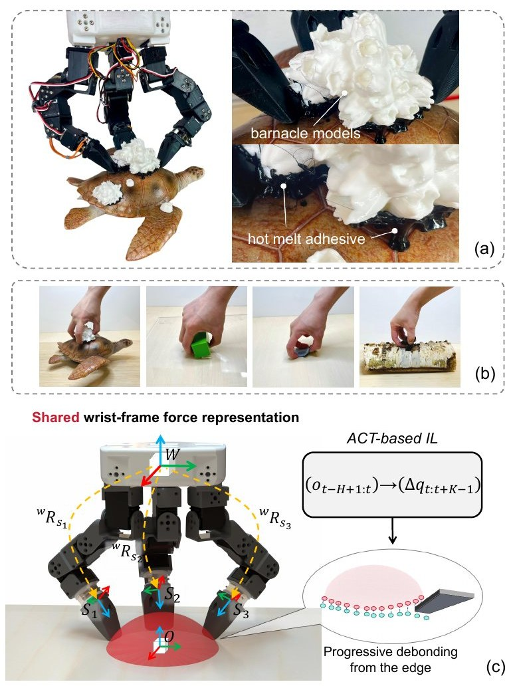
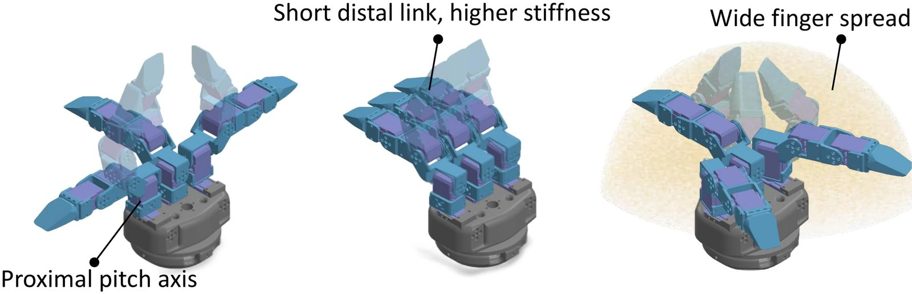
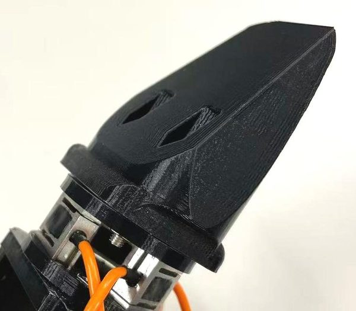
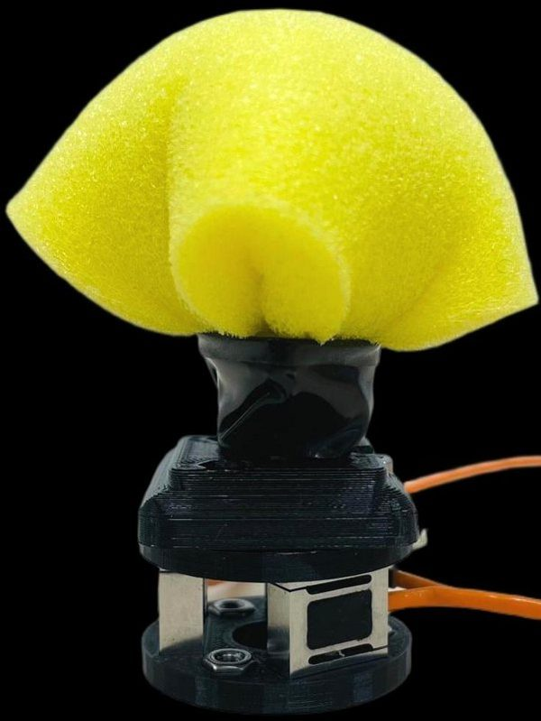
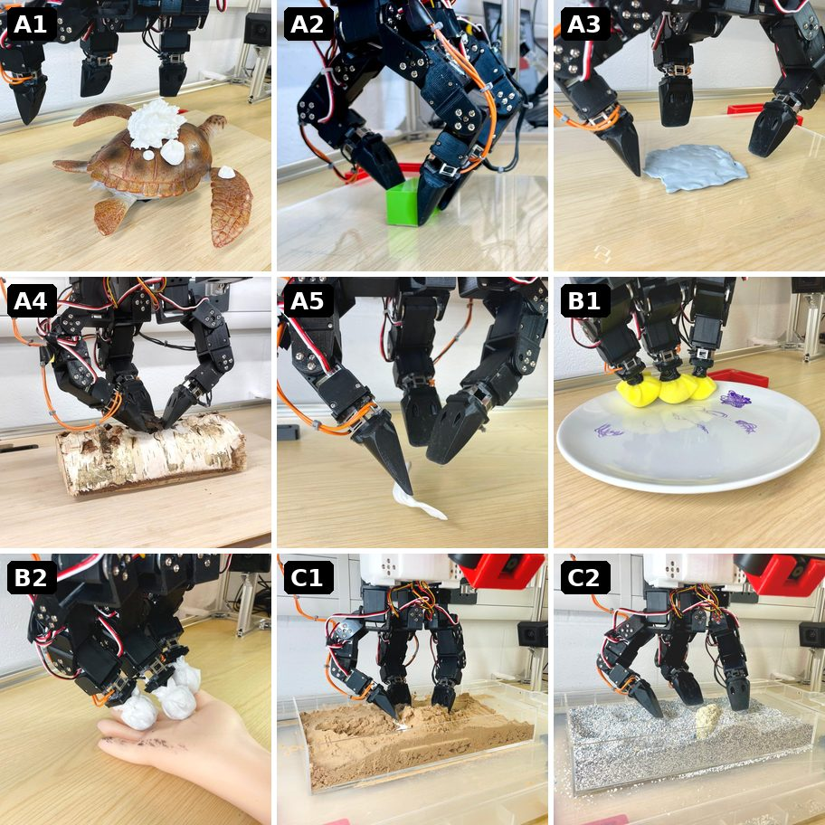
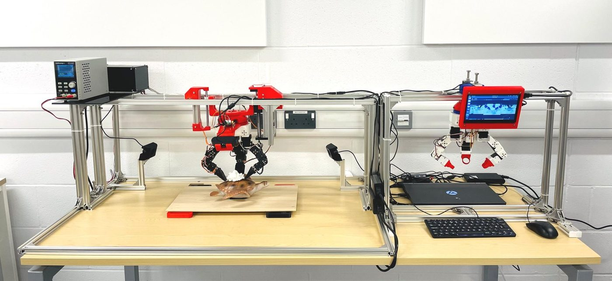
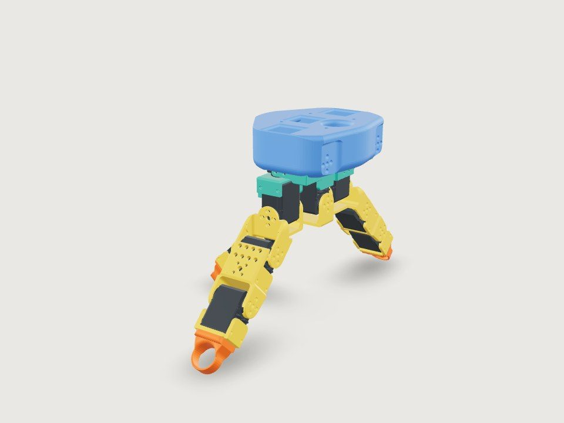
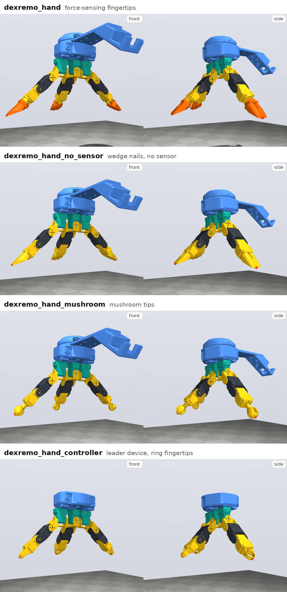

<div align="center">

<a href="https://dexremo.github.io"><picture>
  <source media="(prefers-color-scheme: dark)" srcset="docs/img/wordmark_dark.png">
  
</picture></a>

<h4>A Force-Sensing Hand Platform and Task Suite for Contact-Rich Removal Manipulation</h4>

[Liman Wang](https://limanwang.github.io/#/)<sup>†</sup> · [Hanyang Zhong](https://hanyangzhong.github.io/)<sup>†</sup> · [Zhaole Sun](https://sunzhaole.github.io/) · Wenting Cao · [Babar Jamil](https://www.york.ac.uk/physics-engineering-technology/people/babarjamil/) · [Andy Tyrrell](https://www.york.ac.uk/physics-engineering-technology/people/andy_tyrrell/) · [Shan Luo](https://shanluo.github.io/) · [Jihong Zhu](https://jihong-zhu.github.io/)<sup>*</sup>

<sub>† Equal contribution &nbsp;·&nbsp; * Corresponding author</sub>

<a href="https://dexremo.github.io"><picture>
  <source media="(prefers-color-scheme: dark)" srcset="docs/img/logos_dark.png">
  
</picture></a>

**IEEE Transactions on Robotics (T-RO), 2026**

[](https://arxiv.org/abs/2611.15981)
[](https://arxiv.org/abs/2611.15981)
[](https://dexremo.github.io)
[](https://youtu.be/4ot1Yy7es_o)

[Hardware](hardware/) | [Bill of Materials](hardware/BOM.md) | [Assembly Guide](hardware/assembly/) | [Force Calibration](hardware/force_calibration.md) | [Simulation](sim/)

**English** | [中文](README_zh.md)

🦾 *A three-finger hand that pries, scrapes, wipes and digs: 12 servos, printed in PLA, with optional force sensing in each fingertip.*

</div>

## Overview

Adhered, embedded, contaminated or buried targets cannot simply be grasped. The robot has to work an edge loose, keep pressure on a stain, or uncover what it cannot see. DexRemo is a three-finger hand built for this kind of **removal manipulation**:

- **three identical thumb-like fingers**, 12 degrees of freedom, all driven by the same off-the-shelf serial bus servo;
- **every structural part printed in PLA**, for about $200 in parts;
- **optional three-axis force sensing** in each fingertip, for about $170 per fingertip;
- **62.5 N pullout strength**, the highest among the hands compared in the paper;
- task success rises from **24% to 83%** once fingertip pose and force are expressed in one shared **wrist frame**.

This repository holds the open-source release of DexRemo: hardware files, bill of materials, assembly guide and simulation models.

<p align="center">
  
</p>

## Hand design

Each finger has four joints: two flexion joints (IP and MCP) and a two-axis base (CMC1 and CMC2). The three fingers are arranged radially, so together they reach a hemispherical workspace.



| Feature | What it does |
|---|---|
| Proximal pitch axis | Each finger pitches from its base, so it can fold in towards the palm or open flat |
| Short distal link | Keeps the fingertip stiff when it pushes into a contact |
| Wide finger spread | The fingers swing far apart to cover a hemispherical reachable workspace |

| Specification | Value |
|---|---|
| Degrees of freedom | 12 (4 per finger) |
| Finger length | 162 mm (links 62 / 50 / 49 mm) |
| Actuators | 12 × Feetech STS3215, magnetic encoders |
| Servo loop | 200 Hz, command latency < 5 ms |
| Mass | about 1.8 kg |
| Pullout strength | 62.5 N |

## Fingertips and force sensing

The fingertips are interchangeable. In the force-sensing version, three miniature load cells sit between two sensor plates. The sum of the three readings gives the normal force, and a calibrated linear map gives the two tangential components. The tip mounts on the outer plate, outside the sensing path, so swapping it needs no recalibration.

<table>
<tr>
<td align="center"><br>Rigid wedge tip, for prying and scraping</td>
<td align="center"><br>Mushroom tip, wrapped with a sponge or wipe, for wiping</td>
</tr>
</table>

| Metric | Value |
|---|---|
| Output | Three-axis force: normal and two tangential |
| Calibration fit | R² > 0.986 on every axis |
| Aggregate error | 0.349 N RMSE |
| No-load noise (standard deviation) | 0.0034 N mean, 0.0129 N max |
| Peak normal force seen in tasks | 63.1 N |

The calibration method is in [`hardware/force_calibration.md`](hardware/force_calibration.md).

## Key idea: force in the wrist frame

A fingertip sensor measures force in its own frame, which turns as the finger bends. The same contact force gives a different reading when the finger posture changes. Rotated into the wrist frame with forward kinematics, the force depends only on the physical contact, and all three fingers report in the same frame:

**f**<sub>wrist</sub> = **R**(**q**) · **f**<sub>local</sub>

Together, the three fingers give the policy a 9-D force input. The project page has an [interactive demo](https://dexremo.github.io/#force-frame).

## Results

Six policies share the hand, the 20 demonstrations per task, the ACT backbone and the rollout protocol. Only the fingertip inputs change. Every policy also receives three RGB views and the joint states.

| Fingertip input | Success rate |
|---|---|
| None (vision and joints only) | 24% |
| R: local-frame force | 38% |
| P: fingertip pose | 44% |
| W: wrist-frame force | 58% |
| R + P | 55% |
| **P + W** | **83%** |

All rollouts on the six core tasks, pooled over three seeds. Wrist-frame force beats local-frame force on all six core tasks, with and without fingertip pose.

In total the hand ran 3,420 real-robot evaluation rollouts and more than 100 hours of logged operation, with 23 hardware interruptions.

## Tasks

Nine real-robot removal tasks in three families of constraint. Each has a preparation protocol, a physical success criterion, and held-out objects, poses and colours.



| Family | ID | Task | Constraint |
|---|---|---|---|
| A: adhesion | A1 | Barnacle removal from a turtle shell | Hot-melt adhesive |
| | A2 | 3D-printed part removal from a build plate | Nano-adhesive film |
| | A3 | Blu-Tack removal from an acrylic plate | Blu-Tack adhesion |
| | A4 | Wood-ear extraction from a tree log | Hot-melt adhesive |
| | A5 | Fingertip self-cleaning | Blu-Tack adhesion |
| B: surface stains | B1 | Wiping marker stains from a ceramic plate | Pigment on surface |
| | B2 | Wiping ink marks from silicone skin | Pigment on surface |
| C: granular media | C1 | Fossil excavation in sand | Granular media |
| | C2 | Cat litter clump removal | Granular media |

Videos of a successful rollout and a baseline failure for each task are on the [project page](https://dexremo.github.io/tasks.html).

## Setup and leader device

Demonstrations are collected by teleoperation with a leader device. It has the same joint layout and link geometry as the hand, with 7.4 V servos and a ring fingertip for each of the operator's fingers. After a zero-offset calibration at the start of each session, its joint angles map one-to-one onto the hand, and commands stream at 15 Hz.





The leader's parts, bill of materials and assembly step are in this repository (step 13 of the assembly guide). The teleoperation software follows in R2.

## Repository contents

| Folder | Contents | Licence |
|---|---|---|
| [`hardware/`](hardware/) | Assembly STEP files, printable STL files, [bill of materials](hardware/BOM.md), [assembly guide](hardware/assembly/README.md), [force-sensor calibration method](hardware/force_calibration.md) | CC BY-NC-SA 4.0 |
| [`sim/`](sim/) | URDF and MuJoCo (MJCF) models of the hand (three fingertip versions) and the leader device, with the scripts that build them from the STEP | MIT (meshes: CC BY-NC-SA 4.0) |



## Quick start

**View the hand in MuJoCo:**

```bash
pip install mujoco
python -m mujoco.viewer --mjcf=sim/mjcf/scene.xml
```

**Build one:**

1. Print the parts listed in [`hardware/README.md`](hardware/README.md).
2. Buy the servos, power supply, driver board and fasteners in the [bill of materials](hardware/BOM.md).
3. Follow the [assembly guide](hardware/assembly/README.md) from one finger to the full hand.
4. If you use force-sensing fingertips, calibrate each one with the [calibration method](hardware/force_calibration.md).

## Roadmap

DexRemo opens in three stages, hardware first. Each stage is released when someone outside the team has followed its documentation from start to finish.

| Stage | Contents | Status |
|---|---|---|
| R0 | Project page, paper, video and results | Released |
| R1 | Hardware files, bill of materials, assembly guide, force-sensor calibration method, simulation models and leader device | Released |
| R2 | Python servo driver (ID setup, zero calibration, joint read and write); leader–follower teleoperation in two versions, without force sensing and with a force-sensor interface; live fingertip force display; recording your own demonstrations | In progress |

The force-sensing version leaves one interface open for your sensor: read your transmitter there and apply the calibration from the [calibration method](hardware/force_calibration.md). Everything else (wrist-frame transform, display and recording) then works as is.

## Citation

```bibtex
@article{wang2026dexremo,
  title   = {DexRemo: A Force-Sensing Hand Platform and Task Suite for Contact-Rich Removal Manipulation},
  author  = {Wang, Liman and Zhong, Hanyang and Sun, Zhaole and Cao, Wenting and Jamil, Babar and Tyrrell, Andy and Luo, Shan and Zhu, Jihong},
  journal = {arXiv preprint arXiv:2611.15981},
  year    = {2026},
  note    = {Accepted to IEEE Transactions on Robotics}
}
```

## Licence

Each folder carries its own licence; see [`LICENSE`](LICENSE). Hardware files are under CC BY-NC-SA 4.0: free to build, modify and share for non-commercial use, with attribution and under the same licence. Code and simulation models are under the MIT licence. For commercial use, contact the corresponding author.
