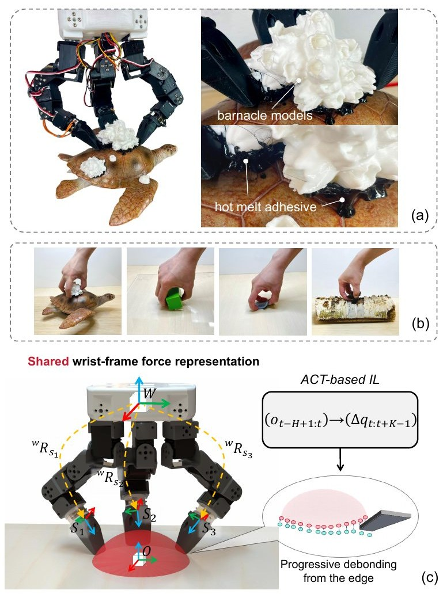
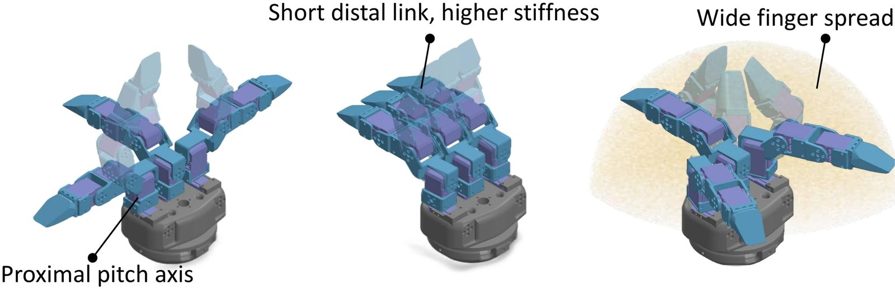
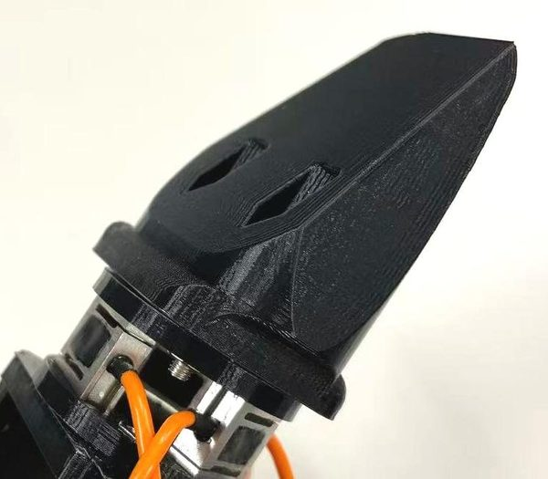
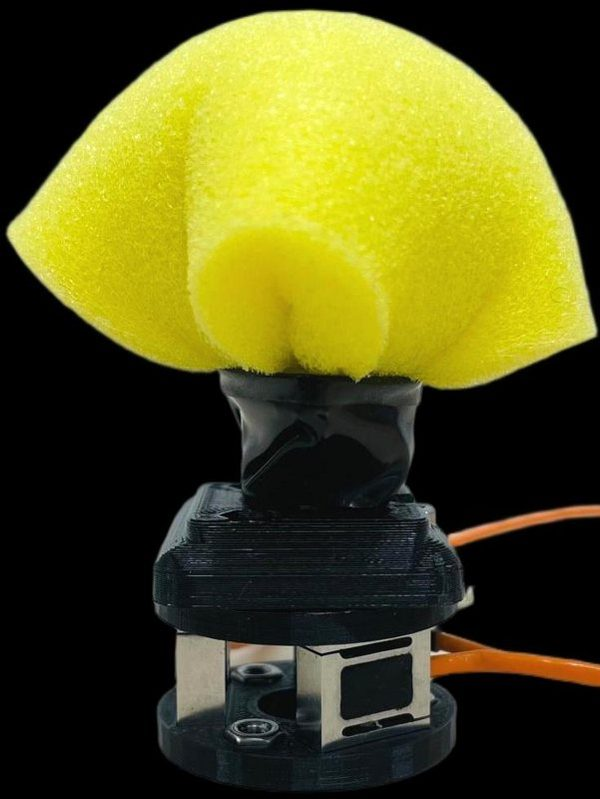
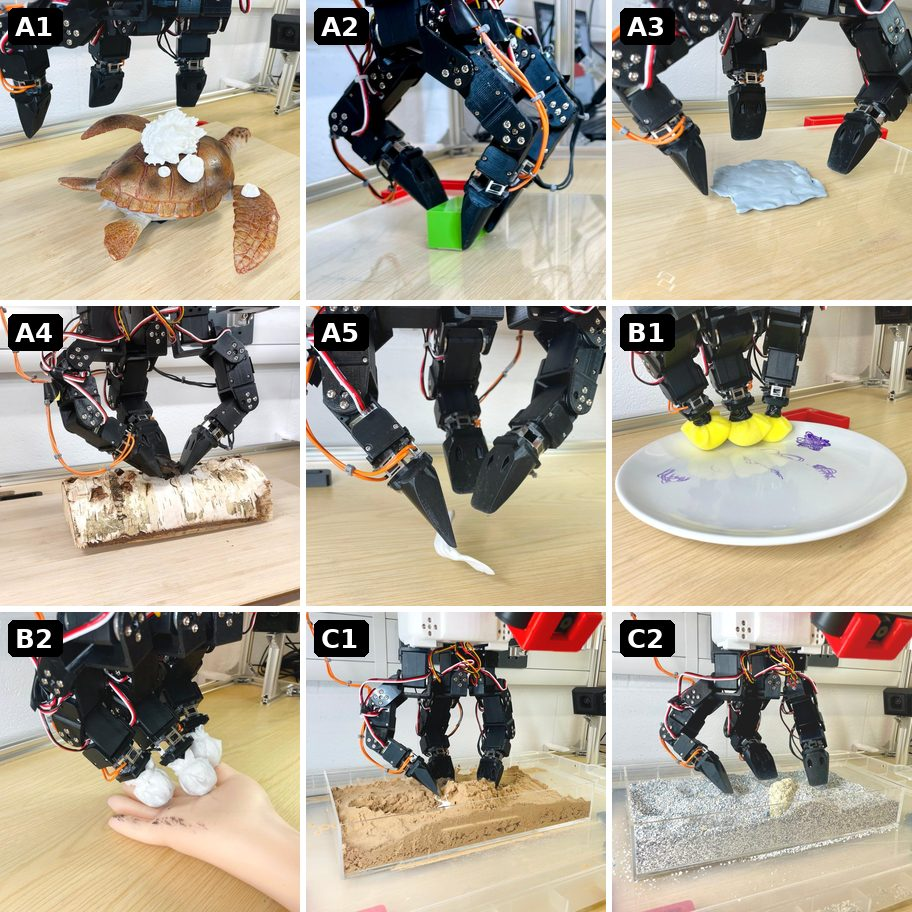
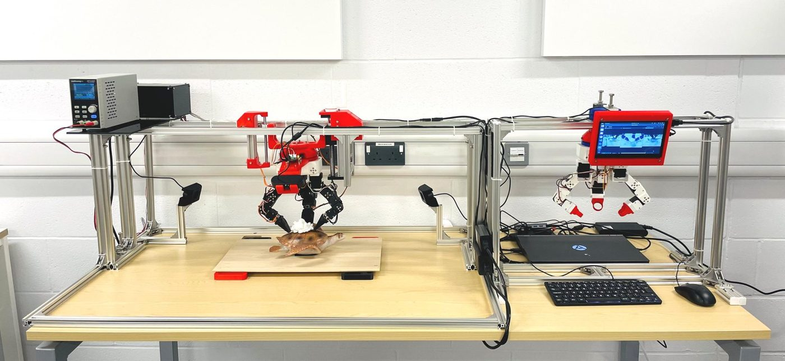
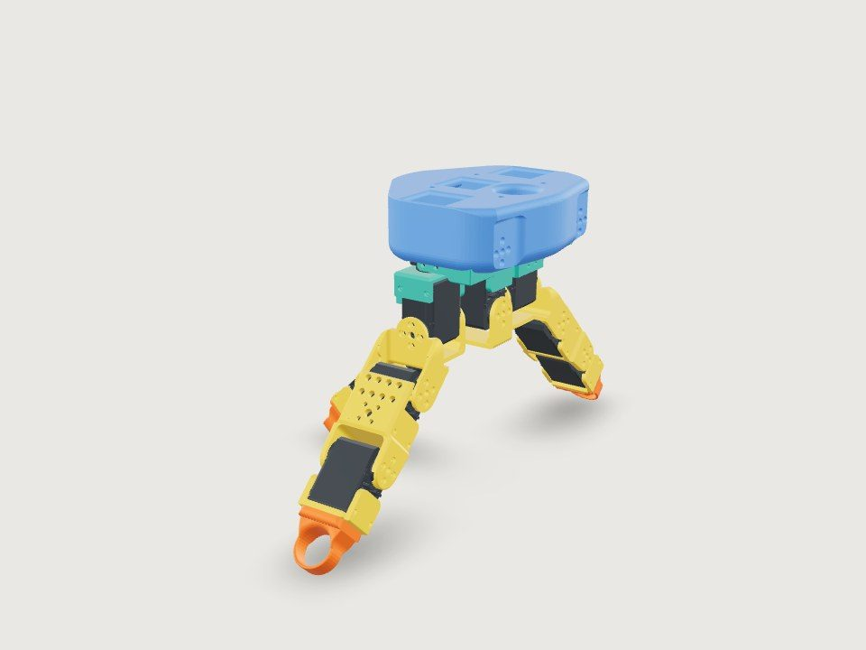
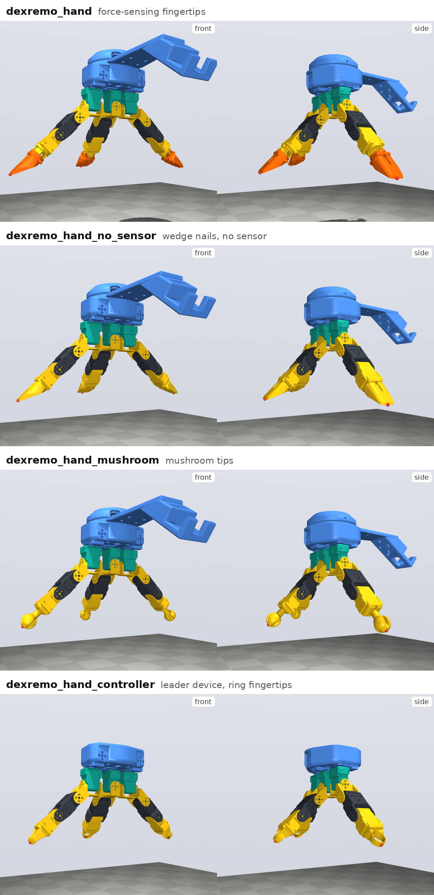

<div align="center">

<h1>DexRemo：面向接触密集型清除操作的<br>力感知灵巧手平台与任务集</h1>

[Liman Wang](https://limanwang.github.io/#/)<sup>†</sup> · [Hanyang Zhong](https://hanyangzhong.github.io/)<sup>†</sup> · [Zhaole Sun](https://sunzhaole.github.io/) · Wenting Cao · [Babar Jamil](https://www.york.ac.uk/physics-engineering-technology/people/babarjamil/) · [Andy Tyrrell](https://www.york.ac.uk/physics-engineering-technology/people/andy_tyrrell/) · [Shan Luo](https://shanluo.github.io/) · [Jihong Zhu](https://jihong-zhu.github.io/)<sup>*</sup>

<sub>† 共同第一作者 &nbsp;·&nbsp; * 通讯作者</sub>

<a href="https://dexremo.github.io"><picture>
  <source media="(prefers-color-scheme: dark)" srcset="docs/img/logos_dark.png">
  
</picture></a>

**IEEE Transactions on Robotics (T-RO)，2026**

[](https://arxiv.org/abs/2611.15981)
[](https://arxiv.org/abs/2611.15981)
[](https://dexremo.github.io)
[](https://youtu.be/4ot1Yy7es_o)

[硬件](hardware/README_zh.md) | [物料清单](hardware/BOM_zh.md) | [装配教程](hardware/assembly/README_zh.md) | [力传感器标定](hardware/force_calibration_zh.md) | [仿真](sim/README_zh.md)

[English](README.md) | **中文**

🦾 *一只会撬、会刮、会擦、会挖的三指灵巧手：12 个舵机，PLA 打印，指尖可选三轴力传感。*

</div>

## 简介

被粘住、嵌住、弄脏或埋住的东西，没法直接抓起来。机器人要先撬起一条边，或者一直压着污渍擦，或者把看不见的东西挖出来。DexRemo 就是为这类**清除操作**设计的三指灵巧手：

- **三根相同的拇指式手指**，共 12 个自由度，全部使用同一款现成的串行总线舵机；
- **所有结构件都用 PLA 打印**，整手材料费约 200 美元；
- **可选的三轴指尖力传感**，每个指尖约 170 美元；
- **62.5 N 拔出力**，论文对比的几款手里最高；
- 把指尖位姿和力统一到**腕部坐标系**后，任务成功率从 **24% 提升到 83%**。

这个仓库是 DexRemo 的开源发布：硬件文件、物料清单、装配教程和仿真模型。

<p align="center">
  
</p>

## 手的设计

每根手指有四个关节：两个屈曲关节（IP、MCP）和一个双轴基关节（CMC1、CMC2）。三根手指沿径向排布，合起来能覆盖一个半球形的工作空间。



| 设计 | 作用 |
|---|---|
| 近端俯仰轴 | 每根手指可以从根部俯仰，向掌心折叠或者完全张开 |
| 短末端连杆 | 指尖推压接触面时更刚，不容易被顶开 |
| 宽手指张角 | 手指可以大幅张开，覆盖半球形的可达空间 |

| 参数 | 数值 |
|---|---|
| 自由度 | 12（每指 4 个） |
| 手指长度 | 162 mm（连杆 62 / 50 / 49 mm） |
| 舵机 | 12 × 飞特 STS3215，磁编码器 |
| 控制频率 | 200 Hz，指令延迟 < 5 ms |
| 质量 | 约 1.8 kg |
| 拔出力 | 62.5 N |

## 指尖与力传感

指尖可以更换。力传感版本在两块传感器板之间夹了三个微型拉压传感器：三个读数相加得到法向力，再用标定得到的线性映射算出两个切向力。指尖工具装在外板上，和传感器在力学上是分开的，所以换指尖不用重新标定。

<table>
<tr>
<td align="center"><br>楔形刚性指尖，用来撬和刮</td>
<td align="center"><br>蘑菇头指尖，可以包海绵或湿巾，用来擦</td>
</tr>
</table>

| 指标 | 数值 |
|---|---|
| 输出 | 三轴力：一个法向、两个切向 |
| 标定拟合 | 每个轴 R² > 0.986 |
| 总体误差 | RMSE 0.349 N |
| 空载噪声（标准差） | 平均 0.0034 N，最大 0.0129 N |
| 任务中的最大法向力 | 63.1 N |

标定方法见 [`hardware/force_calibration_zh.md`](hardware/force_calibration_zh.md)。

## 关键思想：在腕部坐标系里表示力

指尖传感器测的是自身坐标系里的力，而这个坐标系会随着手指弯曲一起转动。同一个接触力，手指姿态一变，传感器的读数就变了。用正运动学把它旋转到腕部坐标系后，读数只跟真实的力有关，而且三根手指的力都在同一个坐标系里：

**f**<sub>wrist</sub> = **R**(**q**) · **f**<sub>local</sub>

三根手指合起来，策略收到一个 9 维的力输入。项目主页上有一个可以拖动的[交互演示](https://dexremo.github.io/#force-frame)。

## 实验结果

六种策略使用同一只手、每个任务同样的 20 条示教、同样的 ACT 网络和同样的测试流程，只有指尖输入不同。所有策略都另外接收三路 RGB 图像和关节状态。

| 指尖输入 | 成功率 |
|---|---|
| 无（只有图像和关节） | 24% |
| R：局部坐标系的力 | 38% |
| P：指尖位姿 | 44% |
| W：腕部坐标系的力 | 58% |
| R + P | 55% |
| **P + W** | **83%** |

六个核心任务、三个随机种子的全部测试汇总。不论有没有指尖位姿，腕部坐标系的力在六个任务上都比局部坐标系的力好。

整个项目共做了 3,420 次真机测试，记录了超过 100 小时的运行，期间硬件中断 23 次。

## 任务

九个真机清除任务，分为三类约束。每个任务都有准备流程、物理上的成功判据，以及测试时没见过的物体、位置和颜色。



| 类别 | 编号 | 任务 | 约束 |
|---|---|---|---|
| A 粘附 | A1 | 从海龟壳上清除藤壶 | 热熔胶 |
| | A2 | 从打印平台上取下 3D 打印件 | 纳米胶膜 |
| | A3 | 从亚克力板上清除蓝丁胶 | 蓝丁胶 |
| | A4 | 从树干上取下木耳 | 热熔胶 |
| | A5 | 指尖自清洁 | 蓝丁胶 |
| B 表面污渍 | B1 | 擦掉陶瓷盘上的马克笔痕 | 表面颜料 |
| | B2 | 擦掉硅胶皮肤上的墨迹 | 表面颜料 |
| C 颗粒介质 | C1 | 在沙子里挖化石 | 颗粒介质 |
| | C2 | 清除猫砂结块 | 颗粒介质 |

每个任务的成功和失败视频见[项目主页](https://dexremo.github.io/tasks.html)。

## 实验平台与主手

示教数据用一个主手遥操作采集。主手的关节布局和连杆尺寸和从手一样，只是用 7.4 V 舵机，指尖换成套在操作者手指上的指环。每次使用前做一次零位标定后，主手的关节角一一对应到从手，指令频率 15 Hz。





主手的零件、物料和装配步骤都在本仓库里（装配教程第 13 步）。遥操作软件会在 R2 发布。

## 仓库内容

| 文件夹 | 内容 | 许可证 |
|---|---|---|
| [`hardware/`](hardware/) | 装配 STEP、可打印 STL、[物料清单](hardware/BOM_zh.md)、[装配教程](hardware/assembly/README_zh.md)、[力传感器标定方法](hardware/force_calibration_zh.md) | CC BY-NC-SA 4.0 |
| [`sim/`](sim/) | 三种指尖版本的手和主手的 URDF、MuJoCo (MJCF) 模型，以及从 STEP 生成它们的脚本 | MIT（网格文件：CC BY-NC-SA 4.0） |



## 快速上手

**在 MuJoCo 里查看这只手：**

```bash
pip install mujoco
python -m mujoco.viewer --mjcf=sim/mjcf/scene.xml
```

**自己做一只：**

1. 按 [`hardware/README_zh.md`](hardware/README_zh.md) 打印零件；
2. 按[物料清单](hardware/BOM_zh.md)购买舵机、电源、驱动板和螺丝；
3. 跟着[装配教程](hardware/assembly/README_zh.md)从一根手指装到整只手；
4. 如果用力传感指尖，按[标定方法](hardware/force_calibration_zh.md)标定每个指尖。

## 发布计划

DexRemo 分三个阶段开源，硬件优先。每个阶段在团队外的人照着文档完整走通一遍之后才发布。

| 阶段 | 内容 | 状态 |
|---|---|---|
| R0 | 项目主页、论文、视频、结果 | 已发布 |
| R1 | 硬件文件、物料清单、装配教程、力传感器标定方法、仿真模型、主手 | 已发布 |
| R2 | Python 舵机驱动（ID 设置、零位标定、关节读写）；主从遥操作，分不带力传感和带力传感接口两个版本；实时指尖力显示；录制你自己的示教数据 | 进行中 |

带力传感的版本给传感器留了一个接口：你在这里读取自己的变送器，套上按[标定方法](hardware/force_calibration_zh.md)得到的标定结果，其余部分（转到腕部坐标系、显示和录制）就能直接用。

## 引用

```bibtex
@article{wang2026dexremo,
  title   = {DexRemo: A Force-Sensing Hand Platform and Task Suite for Contact-Rich Removal Manipulation},
  author  = {Wang, Liman and Zhong, Hanyang and Sun, Zhaole and Cao, Wenting and Jamil, Babar and Tyrrell, Andy and Luo, Shan and Zhu, Jihong},
  journal = {arXiv preprint arXiv:2611.15981},
  year    = {2026},
  note    = {Accepted to IEEE Transactions on Robotics}
}
```

## 许可证

每个文件夹有各自的许可证，见 [`LICENSE`](LICENSE)。硬件文件采用 CC BY-NC-SA 4.0，可以自由制作、修改和分享，仅限非商业用途，需要署名并以相同许可证发布。代码和仿真模型采用 MIT 许可证。商业用途请联系通讯作者。
