# DexRemo hand: assembly guide

**English** | [中文](README_zh.md)

This guide builds the hand in four stages:

1. Build one finger (steps 1–13): the finger from its base up to the IP servo, then the fingertip as a separate unit, which is fitted last.
2. Build the other two fingers the same way (step 14).
3. Screw the three fingers onto the palm (step 15).
4. Add the connector, the flange adapter and, if you need it, the camera mount (steps 16–18).

**Fingertip versions**
- The hand can take three fingertips: force-sensing (steps 9–11), plain nail (step 12) or mushroom.
- The leader device for teleoperation is the same hand with ring fingertips (step 13) and 7.4 V servos.
- The leader skips steps 16–18. Mount it on any stand that suits you.

**How to read the pictures**
- New parts are coloured; parts already in place are grey.
- The legend lists the parts used in the step and how many of each.
- The animation plays the step in order: part first, then its screws.

All views are rendered from the assembly STEP files in [`../step/assembly/`](../step/assembly/). Open those files in any CAD viewer to check a detail from another angle.

## Before you start

**Parts.** You need:
- the printed parts listed in [`../README.md`](../README.md#printed-parts);
- the bought parts and fasteners listed in the [bill of materials](../BOM.md).

**Nuts embedded while printing.** Only the fingertip sensor's inner plate (`force_sensor_layer1`) needs nuts placed during the print: three M3 nuts each. The fingernails and the leader's rings take their nuts after printing.

Print the inner plates from [`../print/force_sensor_layer1.3mf`](../print/). It is a Bambu Studio project for Bambu Lab printers, with the pause already set at layer 22 (3.56 mm).

1. When the printer pauses, push the three M3 nuts into the hex pockets.
2. Resume straight away. Be quick: if the part cools for too long, the next layer may not bond to it and the plate can split.

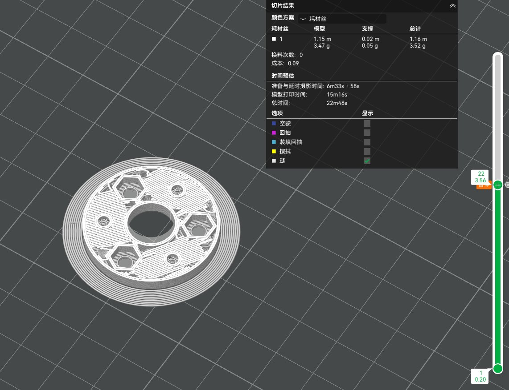

On another printer, slice `force_sensor_layer1.stl` with 0.16 mm layers (0.2 mm first layer) and insert a pause at 3.56 mm, at the start of layer 22. Most slicers call this "Add pause" or "Pause at height". Check in the preview that the hex pockets are still open at the pause.

**Servo IDs.** Every servo on the bus needs its own ID. Set each servo's ID before you build it in, then label the servo. Use the [ID map](#servo-id-map) below.

---

## Stage 1: one finger

These steps show the left finger. The middle and right fingers are built the same way; step 14 lists what differs.

### Step 1: CMC1 housing, hide the nuts

Push four M3 nuts into the hex pockets on the outside of the CMC1 housing. They take the screws that later hold the finger on the palm.

The first part depends on the finger:

| Finger | CMC1 housing |
|---|---|
| Left | `CMC1_left_joint` |
| Middle and right | `CMC1_mid_right_joint` |

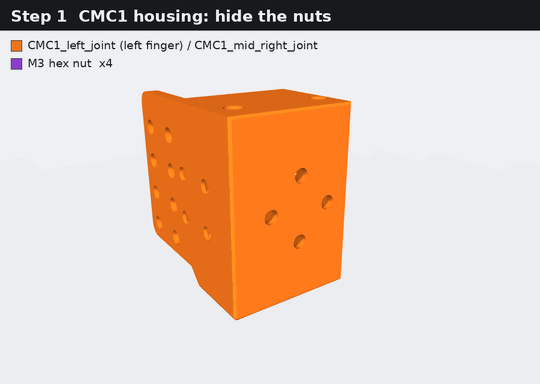

### Step 2: CMC1 servo into the housing

Slide the CMC1 servo into the housing. Fix it with four ST2.2×4.5 self-tapping screws.

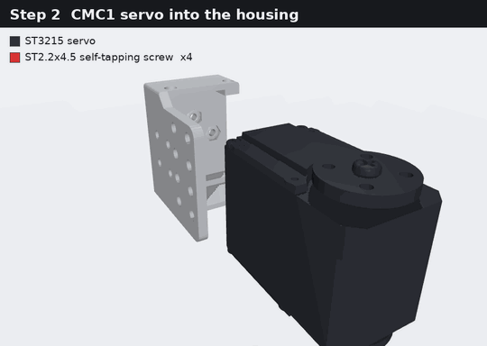

### Step 3: CMC2 bracket onto the CMC1 servo horn

Place the CMC2 bracket (`CMC2_joints`) on the CMC1 servo's horn. Screw it to the horn with four M3×6 countersunk screws.

Fit these screws now. The CMC2 servo covers them in the next step.

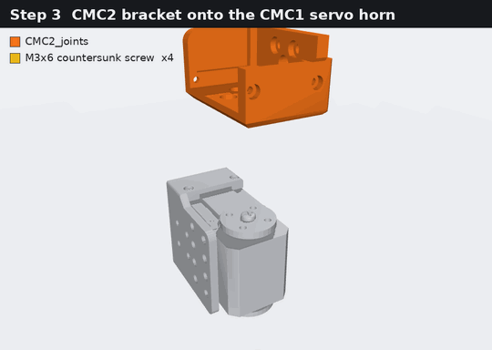

### Step 4: CMC2 servo into the CMC2 bracket

Slide the CMC2 servo into the bracket. Fix it with four ST2.2×4.5 self-tapping screws.

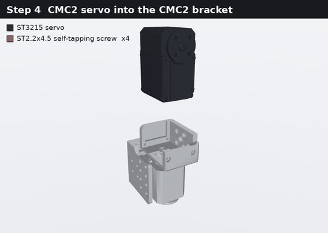

### Step 5: MCP link onto the CMC2 servo

Place the MCP link (`MCP_joints`) on the CMC2 servo. Fix it with eight M3×6 countersunk screws: four into the horn and four into the opposite side of the servo.

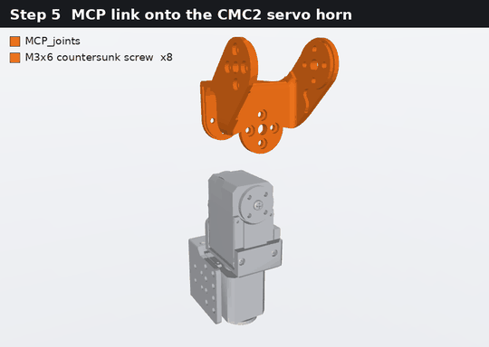

### Step 6: MCP servo onto the MCP link

Place the MCP servo between the free arms of the MCP link. Fix it with eight M3×6 countersunk screws.

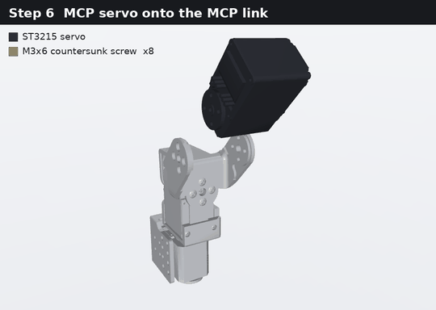

### Step 7: IP link over the MCP servo

Slide the IP link (`IP_joints`) over the MCP servo. Fix it with four ST2.2×4.5 self-tapping screws.

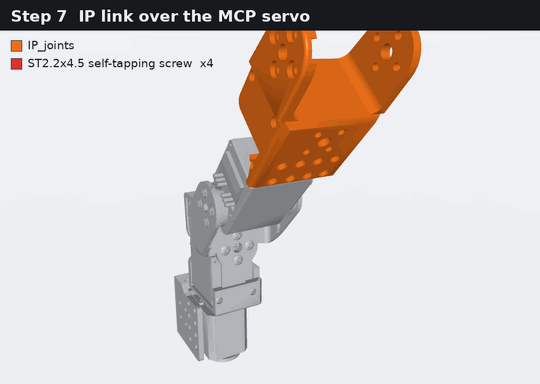

### Step 8: IP servo onto the IP link

Place the IP servo between the free arms of the IP link. Fix it with eight M3×6 countersunk screws.

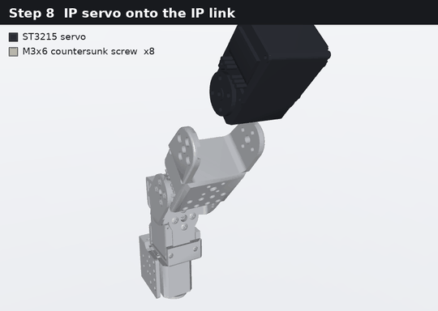

### Step 9: fingertip sensor

Build the fingertip on the bench before fitting it to the finger. The three load cells sit between the two sensor plates (`force_sensor_layer1`).

Before you start, label, wire and check the load cells as in steps 1–3 of the [calibration method](../force_calibration.md).

1. Take the inner plate, with its three embedded M3 nuts.
2. Fit the three load cells to it by their labels (+X, +Y, −Y; see the [sensor frame](../force_calibration.md#sensor-frame-and-load-cell-names)), each with one M2.5×3 screw and threadlocker.
3. Place the outer plate on the load cells. Fix it with three M2.5×3 screws and threadlocker, one into each load cell. Draw the +X and +Y arrows on the outer plate.
4. Fit the fingernail on the outer plate.

Each finger has its own nail: `left_finger_nail`, `mid_finger_nail` or `right_finger_nail`.

Skip steps 9 and 10 if you are building the version without force sensing; go to step 12.

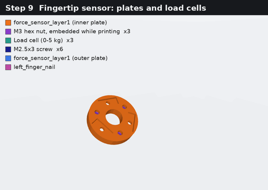

### Step 10: distal link onto the sensor

Fit the distal link (`fingertip_joints`) onto the inner plate from below. Fix it with three M3×6 screws from inside the distal link into the embedded nuts.

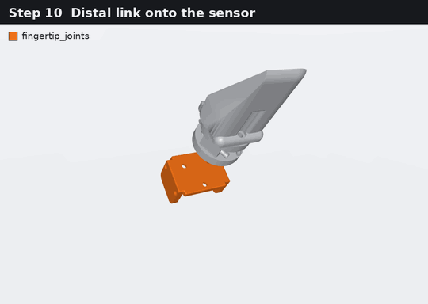

### Step 11: fingertip onto the IP servo

Slide the whole fingertip unit over the IP servo. Fix it with four ST2.2×4.5 self-tapping screws through the distal link.

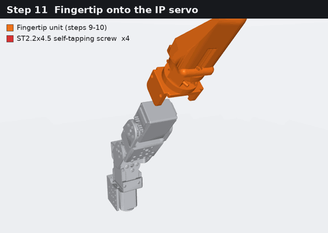

### Step 12: version without force sensing

Push three M3 nuts into the fingernail, then fit it straight onto the distal link. Fix it with three M3×6 screws from inside the distal link. Then fit the fingertip onto the IP servo as in step 11.

The mushroom fingertip (`mushroom_finger`) fits the same way. It is for holding a sponge or a wet wipe.

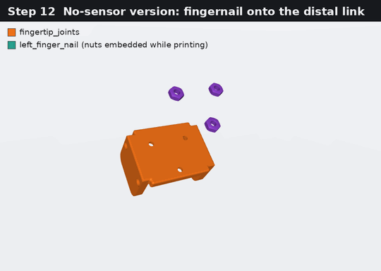

### Step 13: leader device, ring fingertip

The leader device has a ring (`controller_finger`) instead of a nail, for the operator's fingertip.

Push three M3 nuts into the ring, then fit it onto the distal link. Fix it with three M3×6 screws from inside the distal link. Then fit the fingertip onto the IP servo as in step 11.

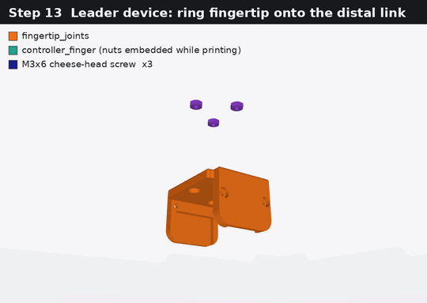

## Stage 2: three fingers

### Step 14: build the other two fingers

Repeat steps 1–13 for the middle and right fingers. The three fingers differ in only two parts:

| Finger | CMC1 housing | Fingernail |
|---|---|---|
| Left | `CMC1_left_joint` | `left_finger_nail` |
| Middle | `CMC1_mid_right_joint` | `mid_finger_nail` |
| Right | `CMC1_mid_right_joint` | `right_finger_nail` |

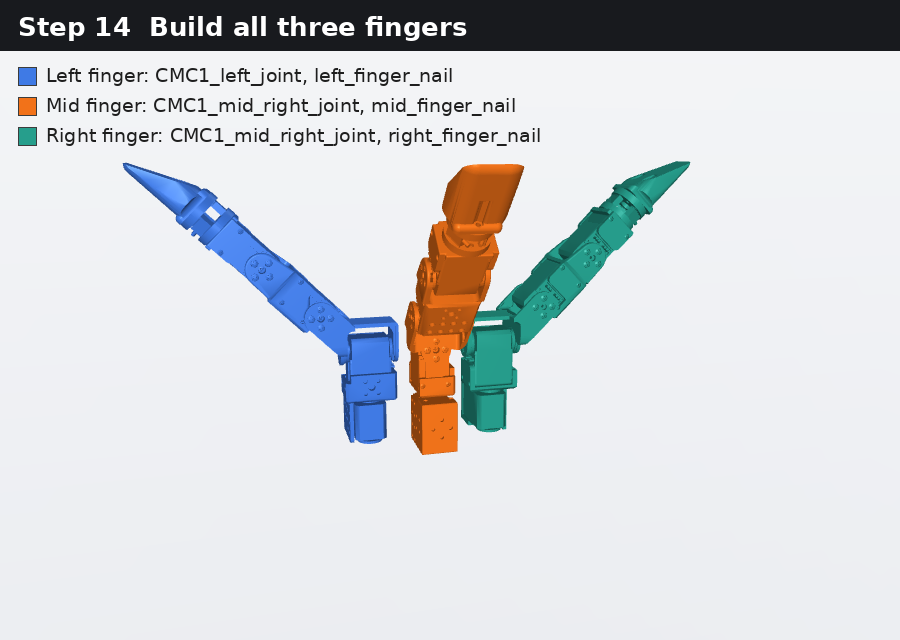

## Stage 3: fingers onto the palm

### Step 15: screw the fingers onto the palm

Lower each finger onto the palm (`hand-base`). Fix each one with four M3×12 screws into the nuts you placed in step 1.

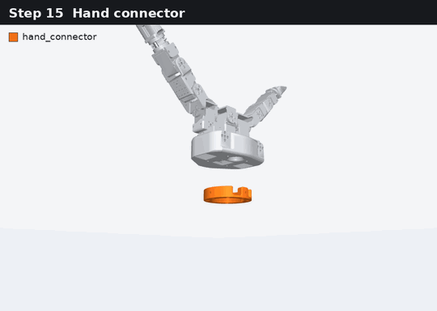

## Stage 4: mounting parts

The STEP does not include the screws for these parts. Choose screw lengths to suit your prints.

### Step 16: hand connector

Screw the hand connector to the underside of the palm.

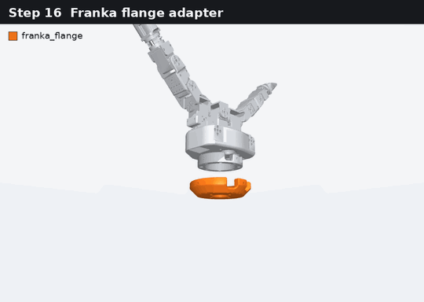

### Step 17: Franka flange adapter

Screw the flange adapter to the connector. The adapter bolts directly onto the Franka Emika flange.

### Step 18: hand-eye camera mount (optional)

Fit the camera arm (`hand_eye_cam_mount`) under the palm. Then fit the camera holder (`camera_mount`) at the end of the arm.

Skip this step if you do not use a wrist camera.

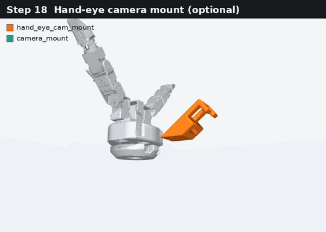

---

## Servo ID map

Within each finger, IDs run from the palm out to the fingertip.

| Finger | CMC1 | CMC2 | MCP | IP |
|---|---|---|---|---|
| Right | 1 | 2 | 3 | 4 |
| Middle | 5 | 6 | 7 | 8 |
| Left | 9 | 10 | 11 | 12 |

The joint names match the simulation model (`left_cmc1` … `right_ip`). See [`../../sim/README.md`](../../sim/README.md#joints) for each joint's axis and sign.

## After assembly

1. Connect the servo driver board, the power supply and the servo bus.
2. Move the hand by hand into the zero pose shown in [`../../sim/README.md`](../../sim/README.md#zero-pose): side fingers turned outwards, each finger bent into a hook.
3. Record each servo's position as its zero offset.
4. If the hand has force-sensing fingertips, calibrate each one on the rig: steps 5–7 of the [calibration method](../force_calibration.md).
