# DexRemo 灵巧手：装配教程

[English](README.md) | **中文**

整只手分四个阶段装：

1. 装一根手指（第 1–13 步）：从手指根部装到 IP 舵机，指尖单独组装成一个整体，最后再装上去。
2. 用同样的方法装另外两根手指（第 14 步）。
3. 把三根手指拧到手掌上（第 15 步）。
4. 装连接件、法兰转接件，需要的话再装相机支架（第 16–18 步）。

**指尖版本**
- 手可以装三种指尖：力传感（第 9–11 步）、普通指甲（第 12 步）或蘑菇头。
- 遥操作用的主手就是同一只手，换成指环指尖（第 13 步）和 7.4 V 舵机。
- 主手跳过第 16–18 步，用你自己合适的支架架起来就行。

**怎么看图**
- 新装的零件是彩色的，已经装好的零件是灰色的。
- 图例列出这一步用到的零件和数量。
- 动画按顺序播放：先装零件，再拧螺丝。

所有图都是从 [`../step/assembly/`](../step/assembly/) 里的装配 STEP 渲染的。想从别的角度看细节，可以用任意 CAD 软件打开这些文件。

## 开始之前

**零件。** 你需要：
- [`../README_zh.md`](../README_zh.md#打印件) 里列出的打印件；
- [物料清单](../BOM_zh.md)里的外购件和紧固件。

**打印时埋入的螺母。** 只有指尖传感器的内板（`force_sensor_layer1`）需要在打印时埋螺母，每块三颗 M3 螺母。指甲和主手指环的螺母在打印完后再装，指环上专门留了滑槽，螺母可以直接推进去。

内板请用 [`../print/force_sensor_layer1.3mf`](../print/) 打印。这是拓竹 Bambu Studio 的工程文件，已经在第 22 层（3.56 mm）设好了暂停。

1. 打印机暂停后，把三颗 M3 螺母压进六角槽里。
2. 马上按继续。动作要快：停得太久零件会冷却，下一层粘不牢，板子容易分层。

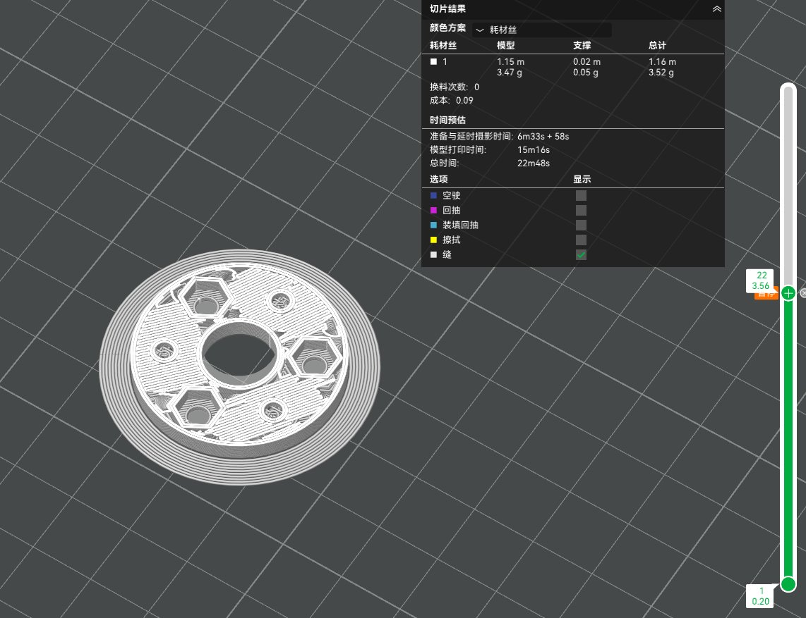

用其他打印机的话，用 0.16 mm 层高（首层 0.2 mm）切片 `force_sensor_layer1.stl`，在 3.56 mm（第 22 层开始）处插入暂停。大多数切片软件里这个功能叫"添加暂停"或"在指定高度暂停"。在预览里确认暂停时六角槽还是敞开的。

**舵机 ID。** 总线上每个舵机都要有自己的 ID。装进去之前先设好每个舵机的 ID，并在舵机上贴标签。ID 按下面的 [ID 表](#舵机-id-表)分配。

---

## 阶段一：一根手指

下面以左指为例。中指和右指的装法一样，不同之处见第 14 步。

### 第 1 步：CMC1 支架，先藏螺母

把四颗 M3 螺母压进 CMC1 支架外侧的六角槽里。之后把手指固定到手掌上的螺丝就拧进这些螺母。

第一个零件按手指不同：

| 手指 | CMC1 支架 |
|---|---|
| 左指 | `CMC1_left_joint` |
| 中指和右指 | `CMC1_mid_right_joint` |

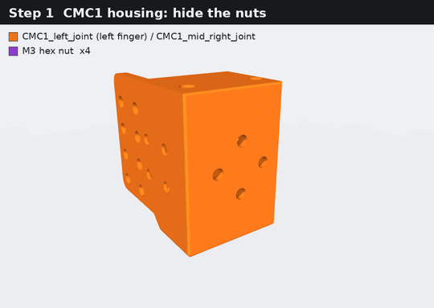

### 第 2 步：CMC1 舵机装进支架

把 CMC1 舵机推进支架，用四颗 ST2.2×4.5 自攻螺丝固定。

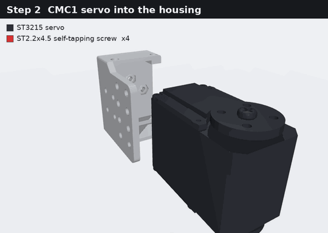

### 第 3 步：CMC2 支架装到 CMC1 舵盘上

把 CMC2 支架（`CMC2_joints`）放到 CMC1 舵机的舵盘上，用四颗 M3×6 沉头螺丝拧到舵盘上。

这几颗螺丝要现在拧，下一步装上 CMC2 舵机后就够不着了。

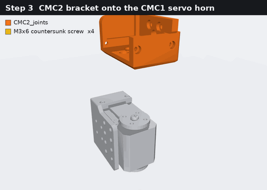

### 第 4 步：CMC2 舵机装进 CMC2 支架

把 CMC2 舵机推进支架，用四颗 ST2.2×4.5 自攻螺丝固定。

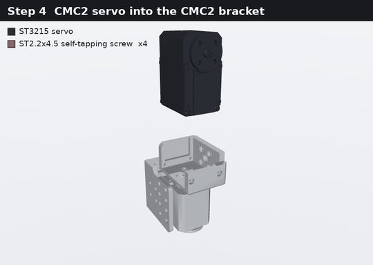

### 第 5 步：MCP 连杆装到 CMC2 舵机上

把 MCP 连杆（`MCP_joints`）装到 CMC2 舵机上，用八颗 M3×6 沉头螺丝固定：四颗拧进舵盘，四颗拧进舵机另一侧。

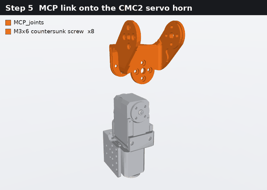

### 第 6 步：MCP 舵机装到 MCP 连杆上

把 MCP 舵机放进 MCP 连杆空着的两臂之间，用八颗 M3×6 沉头螺丝固定。

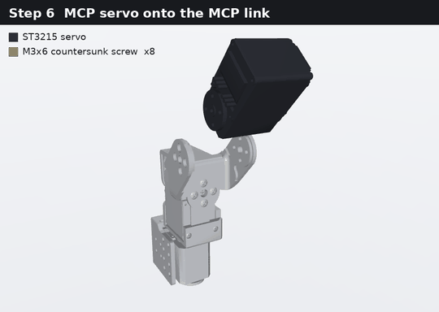

### 第 7 步：IP 连杆套到 MCP 舵机上

把 IP 连杆（`IP_joints`）套到 MCP 舵机上，用四颗 ST2.2×4.5 自攻螺丝固定。

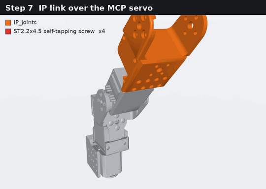

### 第 8 步：IP 舵机装到 IP 连杆上

把 IP 舵机放进 IP 连杆空着的两臂之间，用八颗 M3×6 沉头螺丝固定。

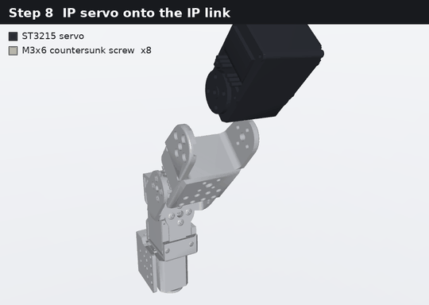

### 第 9 步：指尖传感器

指尖先在桌上组装好，再装到手指上。三个拉压力传感器夹在两块传感器板（`force_sensor_layer1`）之间。

开始之前，先按[标定方法](../force_calibration_zh.md)的第一到第三步给拉压力传感器贴标签、接线并检查。

1. 拿出内板，里面已经埋好三颗 M3 螺母。
2. 按标签（+X、+Y、−Y，位置见[坐标系](../force_calibration_zh.md#坐标系和传感器编号)）把三个拉压力传感器装到内板上，每个用一颗 M2.5×3 螺丝，加螺丝胶。
3. 把外板盖到传感器上，用三颗 M2.5×3 螺丝加螺丝胶固定，每个传感器一颗。在外板上画出 +X 和 +Y 箭头。
4. 把指甲装到外板上。

每根手指有自己的指甲：`left_finger_nail`、`mid_finger_nail` 或 `right_finger_nail`。

如果装的是不带力传感的版本，跳过第 9 和第 10 步，直接看第 12 步。

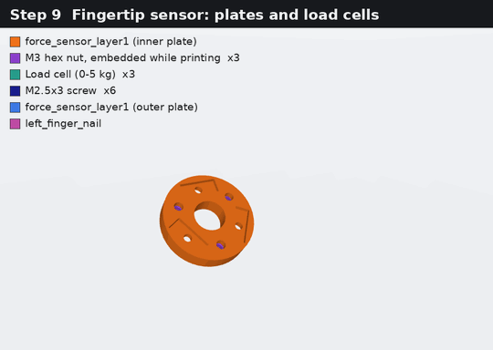

### 第 10 步：末端连杆装到传感器上

把末端连杆（`fingertip_joints`）从下面装到内板上，从末端连杆里面用三颗 M3×6 螺丝拧进埋好的螺母。

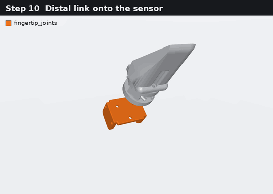

### 第 11 步：指尖装到 IP 舵机上

把整个指尖套到 IP 舵机上，用四颗 ST2.2×4.5 自攻螺丝穿过末端连杆固定。

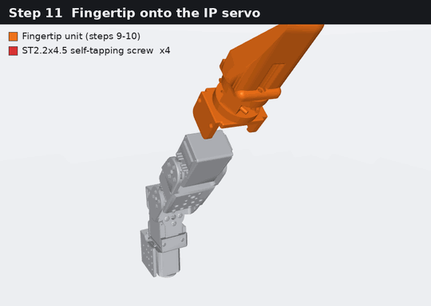

### 第 12 步：不带力传感的版本

把三颗 M3 螺母塞进指甲，再把指甲直接装到末端连杆上，从末端连杆里面用三颗 M3×6 螺丝固定。然后按第 11 步把指尖装到 IP 舵机上。

蘑菇头指尖（`mushroom_finger`）的装法一样，用来包海绵或湿巾。

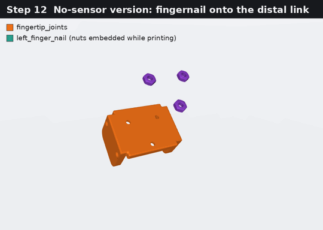

### 第 13 步：主手，指环指尖

主手用指环（`controller_finger`）代替指甲，套在操作者的手指上。

把三颗 M3 螺母沿滑槽推进指环，再把指环装到末端连杆上，从末端连杆里面用三颗 M3×6 螺丝固定。然后按第 11 步把指尖装到 IP 舵机上。

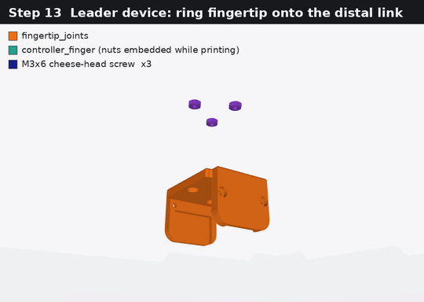

## 阶段二：三根手指

### 第 14 步：装另外两根手指

中指和右指重复第 1–13 步。三根手指只有两个零件不同：

| 手指 | CMC1 支架 | 指甲 |
|---|---|---|
| 左指 | `CMC1_left_joint` | `left_finger_nail` |
| 中指 | `CMC1_mid_right_joint` | `mid_finger_nail` |
| 右指 | `CMC1_mid_right_joint` | `right_finger_nail` |

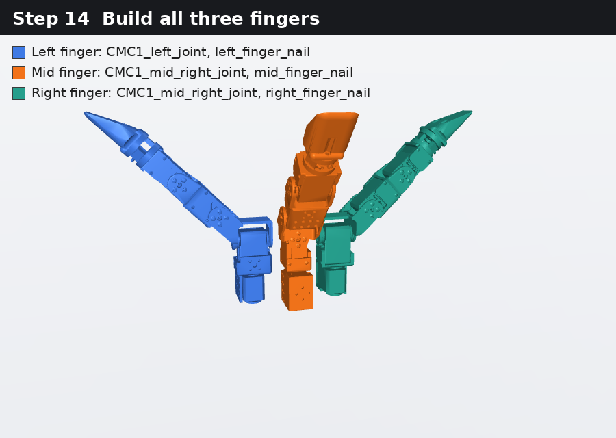

## 阶段三：手指装到手掌上

### 第 15 步：把手指拧到手掌上

把每根手指放到手掌（`hand-base`）上，用四颗 M3×12 螺丝拧进第 1 步藏好的螺母。

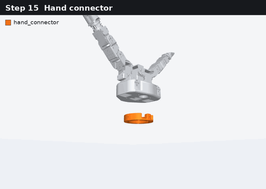

## 阶段四：安装件

STEP 里没有这些零件的螺丝，长度按你的打印件自己选。

### 第 16 步：连接件

把连接件拧到手掌底面。

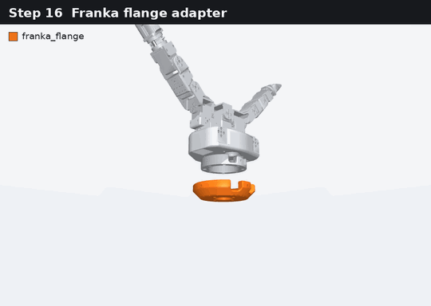

### 第 17 步：Franka 法兰转接件

把法兰转接件拧到连接件上。转接件可以直接装到 Franka Emika 的法兰上。

### 第 18 步：手眼相机支架（可选）

把相机支臂（`hand_eye_cam_mount`）装到手掌下面，再把相机座（`camera_mount`）装到支臂末端。

不用手腕相机的话跳过这一步。

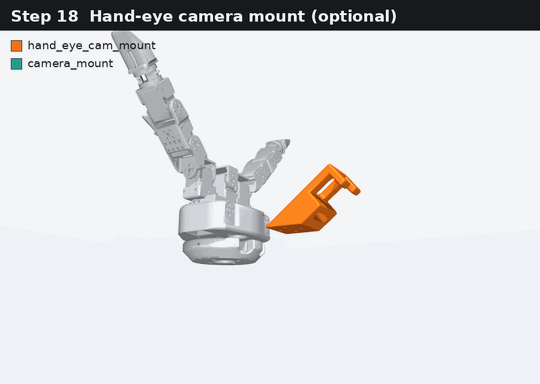

---

## 舵机 ID 表

每根手指里，ID 从手掌往指尖方向排。

| 手指 | CMC1 | CMC2 | MCP | IP |
|---|---|---|---|---|
| 右指 | 1 | 2 | 3 | 4 |
| 中指 | 5 | 6 | 7 | 8 |
| 左指 | 9 | 10 | 11 | 12 |

关节名和仿真模型一致（`left_cmc1` … `right_ip`）。每个关节的转轴和正方向见 [`../../sim/README_zh.md`](../../sim/README_zh.md#关节)。

## 装好之后

1. 接上舵机驱动板、电源和舵机总线。
2. 用手把手掰到 [`../../sim/README_zh.md`](../../sim/README_zh.md#零位) 里的零位：两侧手指朝外转，每根手指弯成钩状。
3. 记录每个舵机此时的位置，作为零位偏置。
4. 如果是力传感指尖，在标定架上逐个标定：[标定方法](../force_calibration_zh.md)的第五到第七步。
