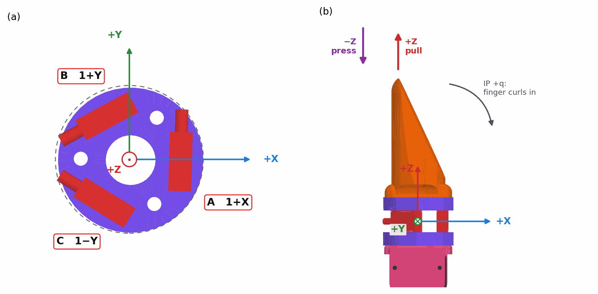
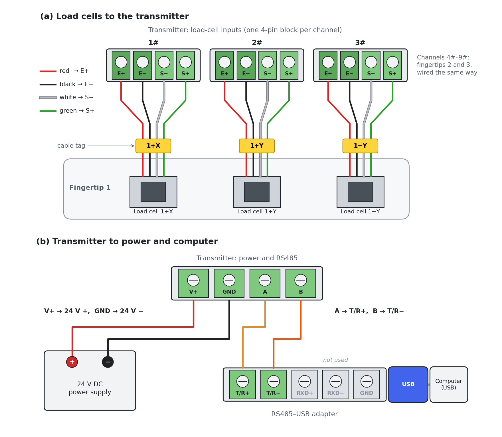
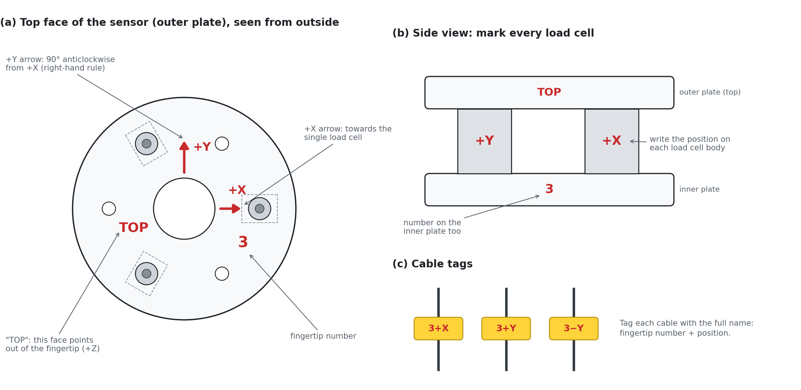

# DexRemo fingertip force sensor: calibration method

**English** | [中文](force_calibration_zh.md)

Each force-sensing fingertip measures a three-axis contact force with three single-axis load cells. Before you use it, calibrate the assembled fingertip once against known weights.

This page describes the method we use. We do not publish acquisition code: it depends on the load-cell transmitter you choose. Any transmitter that gives one reading per load cell works with this method.

## How the sensor works

The three load cells sit in a triangle between the inner and the outer sensor plate. Each cell measures the force along its own axis. If the plates are rigid and deform only slightly, each reading is a linear projection of the contact force **F** onto that cell's axis. The three readings therefore map linearly onto the three force components:

- **Normal force:** *F<sub>z</sub>* = *f*<sub>1</sub> + *f*<sub>2</sub> + *f*<sub>3</sub>
- **Tangential forces:** [*F<sub>x</sub>*, *F<sub>y</sub>*]<sup>T</sup> = **A** [*f*<sub>1</sub>, *f*<sub>2</sub>, *f*<sub>3</sub>]<sup>T</sup> + **b**, with **A** (2×3) and **b** (2×1) fitted from calibration data

The geometry, cross-axis coupling, mounting preload and zero point all differ slightly from one fingertip to the next. So calibrate each assembled fingertip on its own, rather than relying on the load cells' datasheet values.

## Sensor frame and load-cell names



*(a) Seen from outside the fingertip, with the outer plate removed: the inner plate and the three load cells. (b) Side view.*

- **+Z** is the normal of the sensor plates, pointing out of the fingertip. It is the z axis of `{finger}_force_site` in the [simulation model](../sim/README.md#frames).
- **+X** points from the sensor centre to the **single** load cell. This is also the direction in which the fingertip moves when the finger curls in (IP joint, +q).
- **+Y** follows the right-hand rule, **Y** = **Z** × **X**. It is parallel to the IP joint axis. The other two load cells sit on the +Y and −Y sides.

The `{finger}_force_site` frame in the simulation model has exactly these axes.

When you fit the sensor to the finger, look at the hand from the front with the palm on top: +X points up towards the palm and +Y points left. See step 10 of the [assembly guide](assembly/README.md#step-10-distal-link-onto-the-sensor).

Name each load cell by its fingertip number and its position. The fingertip numbers follow the [servo IDs](assembly/README.md#servo-id-map):

| Fingertip | Finger | Load cells |
|---|---|---|
| 1 | Right | 1+X, 1+Y, 1−Y |
| 2 | Middle | 2+X, 2+Y, 2−Y |
| 3 | Left | 3+X, 3+Y, 3−Y |

Picture (a) also labels the three positions A, B and C: A is the +X cell, B is on the +Y side and C is on the −Y side.

## What you need

- the fingertip sensor parts for three fingertips: sensor plates (`force_sensor_layer1`, two per fingertip), load cells (three per fingertip) and M2.5×3 screws;
- threadlocker;
- labels and a marker pen;
- the transmitter, the RS485–USB adapter and the transmitter's datasheet (ask the seller for it);
- a 24 V DC power supply for the transmitter;
- the slotted weight set with its hanger, from the [bill of materials](BOM.md#calibration-tools);
- a calibration rig: an aluminium-profile frame with a few printed parts, which holds the fingertip firmly and can turn it so that any axis points straight up or down. (Parts and photos to follow.)

Each load cell is rated for about 49 N (5 kgf). A force along Z is shared by the three cells; a tangential force is not shared evenly. Loading each axis up to about 1 kg (about 10 N) is enough for calibration.

## Step 1: label and wire the load cells

1. With a marker pen, write each load cell's position on its body: +X, +Y or −Y.
2. Put a tag on the end of each load-cell cable with the full name: fingertip number plus position, for example 1+X, 1+Y, 1−Y. Once the cells are inside the fingertip you cannot see them, and the cable tags are the only way to tell them apart.
3. Connect each load cell to its own transmitter channel. Each channel has a block of four terminals. Connect the wires by colour (check your load cell's datasheet): red → E+, black → E−, white → S−, green → S+.
4. Connect the transmitter's power and signal port: V+ to the positive terminal of the 24 V supply, GND to the negative; A to T/R+ on the RS485–USB adapter, B to T/R−. Leave RXD+, RXD− and GND on the adapter unconnected.



Assign the channels as in this table:

| Channel | 1 | 2 | 3 | 4 | 5 | 6 | 7 | 8 | 9 |
|---|---|---|---|---|---|---|---|---|---|
| Load cell | 1+X | 1+Y | 1−Y | 2+X | 2+Y | 2−Y | 3+X | 3+Y | 3−Y |

We recommend a single 12-channel transmitter; it costs about the same as two smaller ones. Write down the final mapping and read the channels by this table from now on.

## Step 2: write the reading program

1. Get the transmitter's datasheet from the seller. It gives the protocol (usually Modbus over RS485), the register addresses, the baud rate, the data format and the zeroing command.
2. Following the datasheet, write a short Python program that reads every channel. An AI coding assistant (for example ChatGPT or Claude) can write it for you from the datasheet.
3. Connect the transmitter to the computer with the RS485–USB adapter, and check that you can read every channel.

## Step 3: power-on check and reading scale

Check each load cell before you build it into a fingertip:

1. Power on and check that every channel gives a reading.
2. With no load on any cell, send the datasheet's zeroing command to zero the transmitter.
3. Hang a 100 g weight on each load cell in turn. Check that the channel that responds is the one on the cell's label.
4. Set the decimal places and the scale so that the readings are roughly in newtons: 100 g is about 1 N, so the reading should be about 1. For example, if 100 g reads 0.15, the unit is probably kilograms; multiply the readings by 10.

Finish this step before assembly. If you find a wiring or scale mistake after assembly, you have to take the fingertip apart again.

> **Do not send the zeroing command often.** Each zeroing writes to the memory of the transmitter's microcontroller, which only allows a limited number of writes. Step 5 and [Daily use](#daily-use) say when to zero.

## Step 4: build the load cells into the fingertip

1. Fit the three load cells to the inner plate by their names, as in picture (a): the +X cell on its own on one side, the +Y and −Y cells on the other.
2. Fix each cell with an M2.5×3 screw, with threadlocker on the thread.
3. Fit the outer plate, also with M2.5×3 screws and threadlocker. Tighten both sides before you go on.
4. Mark the outer plate (the face that points out of the fingertip) with a marker pen: write "TOP", draw the +X and +Y arrows and write the fingertip number. Write the number on the side of the inner plate too. You will use these marks to find the directions when you mount and calibrate the fingertip.



## Step 5: calibrate on the rig, one axis at a time

Fix the assembled three-axis sensor on the calibration rig. With no load on it, send the zeroing command once, then start calibrating. **Do not zero again during calibration.**

Load each direction in turn: +X, −X, +Y, −Y, +Z, −Z.

**Always calibrate −Z.** Pressing down with the fingertip is the most common load in real tasks.

For each direction:

1. Turn the rig so that the loading direction points straight down. Gravity then pulls the weights along it.
2. For +Z, ±X and ±Y, hang the weight hanger from the fingertip with a cord along the loading direction. For −Z, turn +Z upwards and place the weights directly on the sensor.
3. Add weights in steps, for example 100 g, 200 g, 500 g and 1 kg including the hanger. At each step, wait for the reading to settle, then record the mean of each channel over a few seconds.
4. Note the reference force for each step: *F* = *m* × 9.81 N/kg along the loading direction, zero on the other two axes.

Repeat the whole series at least twice, unloading fully in between, so that you can check repeatability and hysteresis.

## Step 6: fit the mapping

Stack the readings **r** (one row of three channel values per load step) and the reference forces **F** (one row of *F<sub>x</sub>*, *F<sub>y</sub>*, *F<sub>z</sub>* per step). Then fit a linear map with an offset by least squares.

A general 3×3 fit is the simplest choice:

```python
import numpy as np

# r: (N, 3) transmitter readings, in the order A (+X), B (+Y), C (-Y)
# F: (N, 3) reference forces in newtons, in the sensor frame
X = np.hstack([r, np.ones((len(r), 1))])        # add a column for the offset
W, *_ = np.linalg.lstsq(X, F, rcond=None)       # (4, 3): 3x3 gain matrix plus offset row
K, c = W[:3].T, W[3]

def force(reading):                               # reading: (3,) transmitter readings
    return K @ reading + c
```

The paper's structured model (*F<sub>z</sub>* as the sum of the three readings, plus the 2×3 matrix **A** for *F<sub>x</sub>* and *F<sub>y</sub>*) is a special case of this fit. Use it if you prefer fewer parameters.

## Step 7: check the result

Hold back one repeat series from the fit and apply the mapping to it. Then check:

- **R² and RMSE per axis**, between estimated and reference force;
- **cross-axis response**: when one axis is loaded, how much the other two axes read;
- **no-load noise**: the standard deviation of each axis with nothing on the fingertip.

For reference, the three fingertips in the paper reached:

| Metric | Value |
|---|---|
| R², every axis | > 0.986 |
| Force RMSE, all axes | 0.349 N |
| No-load standard deviation (mean / max) | 0.0034 N / 0.0129 N |
| Cross-axis response (mean / max) | 8.2 % / 23.6 % |

## Daily use

After calibration, each time you start, look at the readings with nothing touching the fingertip:

- **If they are close to zero, use them as they are.** A drift of about 1 N does not matter.
- **If they are far off, send the zeroing command.** This usually happens after the power has been off.

## When to recalibrate

- **After taking the sensor apart or re-tightening its screws.** The preload changes the mapping.
- **Not when you swap the fingertip**, or fit another tool on the outer plate. The tip is outside the sensing path.

## Forces in the wrist frame

The paper expresses every fingertip force in one shared frame at the wrist. With the orientation **R**<sub>w,i</sub> of the fingertip's sensor frame from forward kinematics (for example `{finger}_force_site` in the MuJoCo model), the force in the wrist frame is:

**F**<sub>w</sub> = **R**<sub>w,i</sub> **F**<sub>i</sub>

## Using it with the teleoperation code

The teleoperation code (release R2) comes in a version with a force-sensor interface. Read your transmitter there, apply `force()` from step 6 to each fingertip's three readings, and return the forces in the sensor frame. The code then does the wrist-frame transform, the live display and the recording.
