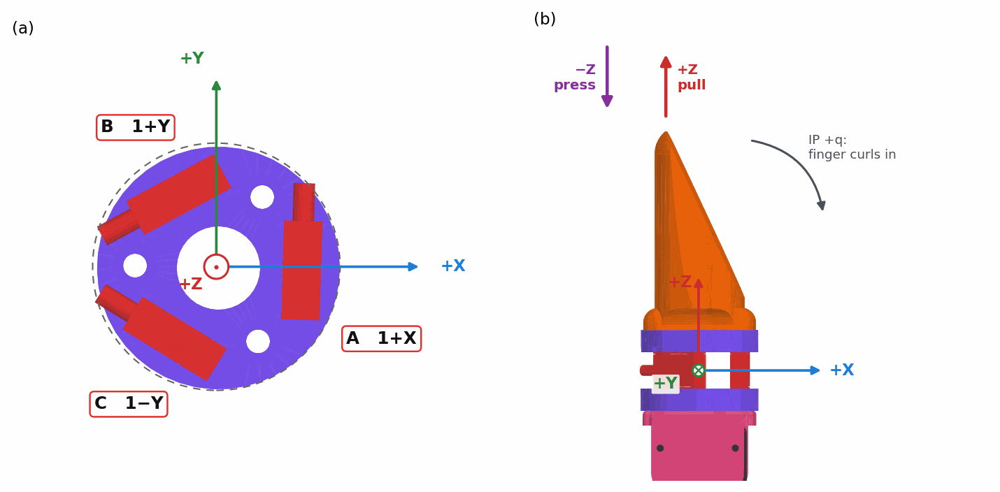

# DexRemo 指尖力传感器：标定方法

[English](force_calibration.md) | **中文**

每个力传感指尖用三个单轴拉压传感器测量三轴接触力。指尖装好后，用已知质量的砝码标定一次再使用。

这里只介绍我们用的方法，不提供采集代码，因为代码取决于你选的变送器。只要变送器能给出每个拉压传感器各自的读数，就可以用这套方法。

## 传感器原理

三个拉压传感器呈三角形排布，夹在内、外两块传感器板之间。每个传感器测量沿自身轴线的力。如果两块板足够刚、变形很小，每个读数就是指尖接触力 **F** 在该传感器轴线上的线性投影，所以三个读数和三个力分量之间是线性关系：

- **法向力：** *F<sub>z</sub>* = *f*<sub>1</sub> + *f*<sub>2</sub> + *f*<sub>3</sub>
- **切向力：** [*F<sub>x</sub>*, *F<sub>y</sub>*]<sup>T</sup> = **A** [*f*<sub>1</sub>, *f*<sub>2</sub>, *f*<sub>3</sub>]<sup>T</sup> + **b**，其中 **A**（2×3）和 **b**（2×1）由标定数据拟合得到

每个指尖的几何尺寸、轴间耦合、安装预紧力和零点都会有些差别，所以每个装好的指尖都要单独标定，不要直接用传感器手册上的参数。

## 坐标系和传感器编号



*(a) 从指尖外侧往里看，去掉外板后的内板和三个拉压传感器。(b) 侧视图。*

- **+Z**：沿传感器板法向，从指尖指向外。和[仿真模型](../sim/README.md#frames)里 `{finger}_force_site` 的 z 轴相同。
- **+X**：从传感器中心指向**单独的那个**拉压传感器。这个方向也是手指向内弯曲（IP 关节 +q）时指尖移动的方向。
- **+Y**：按右手定则，**Y** = **Z** × **X**。它和 IP 关节的转轴平行，另外两个拉压传感器分别在 +Y 和 −Y 两侧。

每个拉压传感器用"指尖编号 + 位置"命名。指尖编号和[舵机 ID](assembly/README_zh.md#舵机-id-表) 的顺序一致：

| 指尖编号 | 手指 | 三个拉压传感器 |
|---|---|---|
| 1 | 右指 | 1+X、1+Y、1−Y |
| 2 | 中指 | 2+X、2+Y、2−Y |
| 3 | 左指 | 3+X、3+Y、3−Y |

上图 (a) 里也用 A、B、C 标出了三个位置：A 是 +X 传感器，B 在 +Y 一侧，C 在 −Y 一侧。

## 需要的东西

- 三个指尖的零件：传感器板（`force_sensor_layer1`，每个指尖 2 块）、拉压传感器（每个指尖 3 个）、M2.5×3 螺丝；
- 螺丝胶；
- 标签纸和记号笔；
- 变送器、RS485 转 USB 模块，以及变送器的规格书（找卖家要）；
- [物料清单](BOM_zh.md#标定工具)里的带挂盘砝码套装；
- 标定架：铝型材架子加几个 3D 打印件，能把指尖牢牢固定住，并能把指尖转到让任意一个轴竖直朝上或朝下。（待补充：零件、照片）

每个拉压传感器的量程约 49 N（5 kgf）。沿 Z 的力由三个传感器分担，切向力则不是平均分担的。标定时每个轴最多加到 1 kg（约 10 N）左右就够了。

## 第一步：贴标签和接线

1. 在每个拉压传感器上写好编号，比如 1+X、1+Y、1−Y。
2. 在每根传感器线的末端也贴上同样编号的标签。装进指尖以后就看不到传感器本体了，只能靠线头上的标签分辨。
3. 按编号把线接到变送器的通道上，比如：

| 通道 | 1 | 2 | 3 | 4 | 5 | 6 | 7 | 8 | 9 |
|---|---|---|---|---|---|---|---|---|---|
| 传感器 | 1+X | 1+Y | 1−Y | 2+X | 2+Y | 2−Y | 3+X | 3+Y | 3−Y |

推荐直接用一台 12 通道的变送器，价格和分开买差不多。记下最终的对应关系，之后的程序都按这张表读数。

## 第二步：写读取程序

1. 找卖家要变送器的规格书，里面会写通信协议（一般是 RS485 上的 Modbus）、寄存器地址、波特率、数据格式和清零命令。
2. 按规格书写一段 Python 程序，读出所有通道的数值。可以把规格书交给 AI 编程助手（比如 ChatGPT 或 Claude），让它帮你写这段代码。
3. 用 RS485 转 USB 模块把变送器接到电脑上，确认能读到所有通道。

## 第三步：上电预检，调好读数的倍率

在把传感器装进指尖之前，先逐个检查：

1. 上电，确认每个通道都能读到数值。
2. 所有传感器空载，用规格书里的清零命令把变送器读数清零。
3. 在每个传感器上挂一个 100 g 砝码，确认有反应的通道就是标签上写的那个传感器。
4. 调整小数点位数和倍率，让读数的单位大致是牛顿（N）：100 g 砝码约等于 1 N，读数应该在 1 左右。比如 100 g 读出来是 0.15，说明当前单位大概是 kg，要把读数乘以 10。

这一步做完再安装。装好以后再发现接错线或者倍率不对，就得拆开重来。

> **不要频繁发送清零命令。** 变送器每次清零都会写入内部单片机的存储器，写入次数有上限，用完就不能再存了。什么时候需要清零，见第五步和[日常使用](#日常使用)。

## 第四步：把传感器装进指尖

1. 按编号把三个拉压传感器装到内板上，位置见上图 (a)：+X 传感器单独在一侧，+Y 和 −Y 在另一侧。
2. 每个传感器用 M2.5×3 螺丝固定，螺纹上点螺丝胶。
3. 盖上外板，同样用 M2.5×3 螺丝加螺丝胶拧紧。两面都拧好再进行下一步。
4. 在外板表面画出 +X 和 +Y 的箭头，方便之后安装和标定时辨认方向。

## 第五步：在标定架上逐轴标定

把装好的三轴传感器固定在标定架上。空载时发送一次清零命令，然后开始标定。**标定过程中不要再清零。**

逐个方向加载：+X、−X、+Y、−Y、+Z、−Z。

**−Z 一定要标。** 指尖往下压是实际任务里最常见的受力情况。

对每个方向：

1. 转动标定架，让加载方向竖直朝下，这样砝码的重力就沿这个方向。
2. 加 +Z、±X、±Y 时，用细绳把砝码挂盘挂在指尖上，让绳子沿加载方向。加 −Z 时，让 +Z 朝上，把砝码直接放在传感器上面。
3. 逐级加砝码，比如 100 g、200 g、500 g、1 kg（包括挂盘）。每一级等读数稳定后，记录每个通道几秒钟内的平均值。
4. 记下每一级的参考力：沿加载方向 *F* = *m* × 9.81 N/kg，另外两个轴为零。

整组加载至少重复两次，中间完全卸载，用来检查重复性和迟滞。

## 第六步：拟合

把读数 **r**（每一级一行，三个通道值）和参考力 **F**（每一级一行，*F<sub>x</sub>*、*F<sub>y</sub>*、*F<sub>z</sub>*）各自叠起来，用最小二乘拟合一个带偏置的线性映射。

最简单的做法是拟合一个通用的 3×3 矩阵：

```python
import numpy as np

# r: (N, 3) 变送器读数，顺序为 A (+X)、B (+Y)、C (−Y) 三个传感器
# F: (N, 3) 传感器坐标系下的参考力，单位 N
X = np.hstack([r, np.ones((len(r), 1))])        # 加一列常数项，用来拟合偏置
W, *_ = np.linalg.lstsq(X, F, rcond=None)       # (4, 3)：3x3 增益矩阵加一行偏置
K, c = W[:3].T, W[3]

def force(reading):                               # reading: (3,) 变送器读数
    return K @ reading + c
```

论文里的结构化模型（*F<sub>z</sub>* 为三个读数之和，*F<sub>x</sub>*、*F<sub>y</sub>* 用 2×3 矩阵 **A**）是这个拟合的特例。想要参数少一些的话可以用它。

## 第七步：检查结果

留出一组重复数据不参与拟合，用拟合结果去算它，然后检查：

- **每个轴的 R² 和 RMSE**：估计的力和参考力之间；
- **轴间耦合**：加载一个轴时，另外两个轴读到多少；
- **空载噪声**：指尖不受力时每个轴的标准差。

论文里三个指尖的结果，供参考：

| 指标 | 数值 |
|---|---|
| R²，每个轴 | > 0.986 |
| 力的 RMSE，所有轴 | 0.349 N |
| 空载标准差（平均 / 最大） | 0.0034 N / 0.0129 N |
| 轴间耦合（平均 / 最大） | 8.2 % / 23.6 % |

## 日常使用

标定完成后，每次开始使用时，先在指尖不受力的状态下看一下读数离零点偏了多少：

- **偏得不多就直接用。** 1 N 左右的漂移不影响使用。
- **偏得很多再发送清零命令。** 这种情况一般出现在断电重启之后。

## 什么时候要重新标定

- **拆过传感器或重新拧过螺丝之后。** 预紧力变了，映射也会变。
- **换指尖不用重新标定**，在外板上装别的工具也一样。指尖不在传力路径上。

## 把力转到腕部坐标系

论文里所有指尖力都表示在腕部的同一个坐标系里。用正运动学得到指尖传感器坐标系的姿态 **R**<sub>w,i</sub>（比如 MuJoCo 模型里的 `{finger}_force_site`），腕部坐标系下的力就是：

**F**<sub>w</sub> = **R**<sub>w,i</sub> **F**<sub>i</sub>

## 接入遥操作代码

遥操作代码（R2 发布）有一个带力传感接口的版本。在这个接口里读取你的变送器，用第六步的 `force()` 把每个指尖的三个读数换算成传感器坐标系下的力，返回即可。转到腕部坐标系、实时显示和录制都由代码完成。
