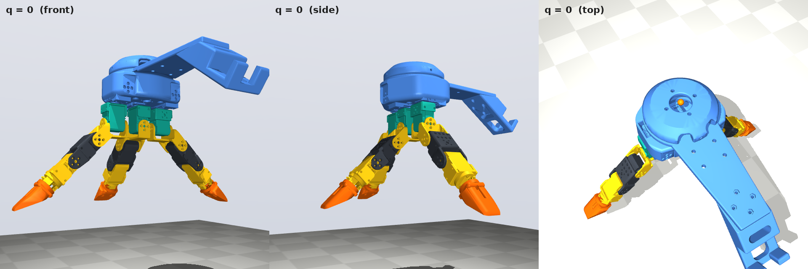
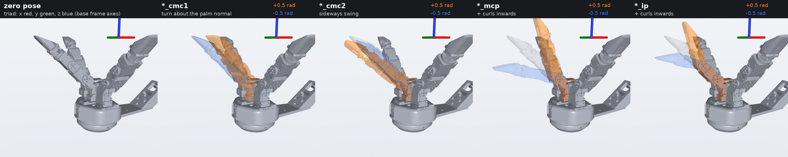

# DexRemo hand: simulation model

URDF and MuJoCo (MJCF) models of the DexRemo three-finger hand, generated from the full-hand STEP assembly.

```
urdf/dexremo_hand.urdf      URDF (ROS, Isaac, PyBullet, ...)
mjcf/dexremo_hand.xml       MJCF: hand only, base_link at the world origin
mjcf/scene.xml              MJCF demo: the hand hangs fingers-down 0.45 m above a floor
meshes/visual/*.stl         one visual mesh per link
meshes/collision/*.stl      convex hulls, one per part
docs/                       zero-pose and joint-convention figures
tools/                      scripts that rebuild this package from the hardware STEP
```

Quick look:

```bash
pip install mujoco
python -m mujoco.viewer --mjcf=mjcf/scene.xml
```

## Frames

- **Base frame (`base_link`)**: the origin sits at the centre of the Franka flange's mounting face, and +z points out of the flange towards the fingers. This is also the `franka_attach` site in the MJCF.
- **Fingertip force frame (`{finger}_force_site`)**: the site lies on the mid-plane of the force sensor, with its z axis along the sensor-plate normal.

## Zero pose

The zero pose (`q = 0`) is the calibration pose of the real hand and of the leader device:

- the middle finger points along -x;
- the left and right fingers are turned outwards, towards +y and -y;
- each finger is bent into a hook.



## Joints

There are 12 revolute joints, four per finger, named `{left|mid|right}_{cmc1|cmc2|mcp|ip}`. All joint angles are in radians.

The positive direction of each joint is defined by this model and is the same on all three fingers. If you drive the real hand, map each servo's sign to this convention once in your driver.



Orange shows +0.5 rad, blue shows -0.5 rad and grey shows zero.

For each finger, let *u* be its outward direction in the palm plane: -x for `mid`, +y for `left` and -y for `right`.

| Joint | Axis at zero pose | What +q does |
|---|---|---|
| `*_cmc1` | +z (palm normal) | turns the whole finger counter-clockwise, seen from the fingertip side |
| `*_cmc2` | *u* | swings the finger sideways, counter-clockwise when seen from outside looking towards the palm centre |
| `*_mcp`  | *u* × z | curls the finger inwards, towards the palm centre |
| `*_ip`   | *u* × z | curls the fingertip inwards |

All axes follow the right-hand rule. Joint ranges are set to ±90° around the zero pose for simulation only; they are not the hardware limits.

## Actuators and sensors (MJCF)

- `{joint}_act`: one position actuator per joint (kp 6, force limit ±1.9 N·m, STS3215 servo).
- `{finger}_force`: 3-axis force at each fingertip sensor, expressed in `{finger}_force_site`.
- `{joint}_pos`: one joint-angle sensor per joint.
- Contacts between the palm and each finger's first link are excluded, because those meshes already overlap at the zero pose.

## Notes

- Masses are rough. Printed parts are modelled as solid PLA (1.24 g/cm³), each servo as 55 g and the load cells as steel. The total comes out at about 2.0 kg. Real prints are partly hollow, so the real hand is lighter.
- Inertias come from the part meshes. Joint damping, armature and friction are generic values, not identified from the hardware.
- The model includes the hand-eye camera mount used in the paper's experiments.

## Rebuilding from the STEP

The `tools/` scripts regenerate this package from `../hardware/step/dexremo_hand_full.step`. They need Python 3.10+ with `cadquery-ocp`, `trimesh`, `scipy` and `mujoco`.

```bash
cd tools
python read_step.py ../../hardware/step/dexremo_hand_full.step step_out   # tessellate every part instance
python links.py step_out                                                  # group parts into links, find the 12 servo joints
python build_model.py step_out ..                                         # write URDF, MJCF and meshes
```

`build_model.py` holds the modelling assumptions at the top: masses, servo limits and the zero-pose angles.

## Licence

The model files (URDF, MJCF) and the scripts in `tools/` are released under the MIT licence (see `LICENSE`). The meshes in `meshes/` are geometry of the hand. Like the rest of the hardware design, they are under CC BY-NC-SA 4.0 (see `../hardware/LICENSE`).
