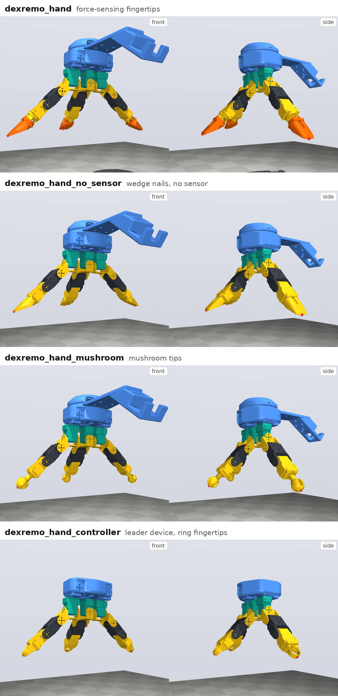
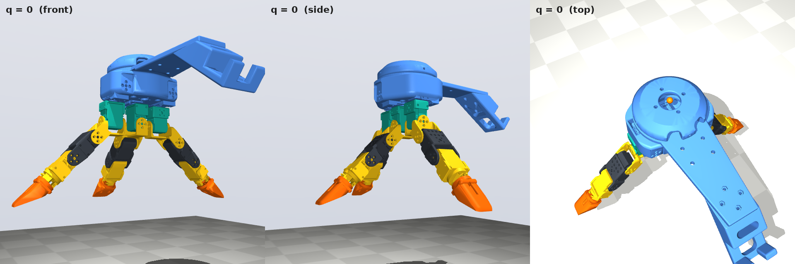
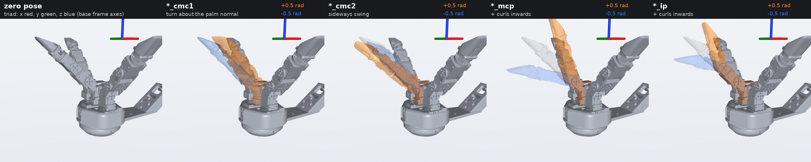

# DexRemo 灵巧手：仿真模型

[English](README.md) | **中文**

DexRemo 三指灵巧手的 URDF 和 MuJoCo (MJCF) 模型，从 [`../hardware/step/`](../hardware/step/) 里的装配 STEP 生成。

一共四个版本。运动学、零位和关节名都一样，只有指尖不同。

| 版本 | 指尖 | 模型 | 演示场景 |
|---|---|---|---|
| `dexremo_hand` | 楔形指甲，装在三轴力传感器上 | `mjcf/dexremo_hand.xml`、`urdf/dexremo_hand.urdf` | `mjcf/scene.xml` |
| `dexremo_hand_no_sensor` | 楔形指甲，不带力传感器 | `mjcf/dexremo_hand_no_sensor.xml`、`urdf/dexremo_hand_no_sensor.urdf` | `mjcf/scene_no_sensor.xml` |
| `dexremo_hand_mushroom` | 蘑菇头（包海绵或湿巾），不带力传感器 | `mjcf/dexremo_hand_mushroom.xml`、`urdf/dexremo_hand_mushroom.urdf` | `mjcf/scene_mushroom.xml` |
| `dexremo_hand_controller` | 套在操作者手指上的指环：主手 | `mjcf/dexremo_hand_controller.xml`、`urdf/dexremo_hand_controller.urdf` | `mjcf/scene_controller.xml` |



主手模型是不带传感器的手，把指甲换成了 `../hardware/step/assembly/dexremo_controller_finger_assemble.step` 里的指环指尖。它没有连接件、法兰转接件和相机支架：真实的主手装在你自己选的支架上。

因为没有法兰，主手的基坐标系在手掌背面的中心（site `mount_site`）。手掌背面沿 z 方向离法兰面 34.5 mm，所以主手的基坐标系和其他版本差这么多。

```
urdf/<version>.urdf                 URDF（ROS、Isaac、PyBullet 等）
mjcf/<version>.xml                  MJCF：只有手，base_link 在世界原点
mjcf/scene*.xml                     MJCF 演示场景：手指朝下，悬在地面上方 0.45 m
meshes/<version>/visual/*.stl       每个连杆一个显示网格
meshes/<version>/collision/*.stl    凸包碰撞网格，每个零件一个
docs/                       零位和关节方向示意图
tools/                      从硬件 STEP 重新生成这套模型的脚本
```

快速查看：

```bash
pip install mujoco
python -m mujoco.viewer --mjcf=mjcf/scene.xml
```

**Isaac Sim / Isaac Lab：** 用 Isaac Sim 的 URDF Importer 导入 `urdf/<version>.urdf`，就能得到 USD 模型。

## 坐标系

- **基坐标系（`base_link`）**：原点在 Franka 法兰安装面的中心，+z 从法兰指向手指。它也是 MJCF 里的 `franka_attach` site。主手模型例外，见上文。
- **指尖力坐标系（`{finger}_force_site`，只有力传感版本有）**：site 在力传感器的中间平面上。坐标轴和[标定](../hardware/force_calibration_zh.md#坐标系和传感器编号)用的传感器坐标系一致：z 沿传感器板法向，从指尖指向外；x 指向单独的那个拉压力传感器，也就是手指向内弯时指尖移动的方向；y = z × x，和 IP 转轴平行。
- **指尖点（`{finger}_tip_site`，所有版本都有）**：指尖的最远端。

## 零位

零位（`q = 0`）就是真实手和主手的标定姿态：

- 中指指向 -x；
- 左指和右指朝外转，分别指向 +y 和 -y；
- 每根手指弯成钩状。



## 关节

一共 12 个转动关节，每指 4 个，命名为 `{left|mid|right}_{cmc1|cmc2|mcp|ip}`。关节角单位都是弧度。

每个关节的正方向由这个模型定义，三根手指相同。驱动真实的手时，在驱动程序里把每个舵机的正负方向对应到这个约定上，只需要做一次。



橙色是 +0.5 rad，蓝色是 -0.5 rad，灰色是零位。

对每根手指，记 *u* 为它在手掌平面内朝外的方向：`mid` 为 -x，`left` 为 +y，`right` 为 -y。

| 关节 | 零位时的转轴 | +q 的效果 |
|---|---|---|
| `*_cmc1` | +z（手掌法向） | 整根手指逆时针转动（从指尖那一侧看） |
| `*_cmc2` | *u* | 手指向侧面摆动，从外面朝手掌中心看是逆时针 |
| `*_mcp`  | *u* × z | 手指向内弯，朝手掌中心 |
| `*_ip`   | *u* × z | 指尖向内弯 |

所有转轴都按右手定则。关节范围在零位两侧各 ±90°，只用于仿真，不是硬件的限位。

## 执行器和传感器（MJCF）

- `{joint}_act`：每个关节一个位置执行器（kp 6，力矩限制 ±1.9 N·m，对应 STS3215 舵机）。
- `{finger}_force`：每个指尖传感器的三轴力，表示在 `{finger}_force_site` 坐标系里（只有力传感版本有）。
- `{finger}_tip_pos`：指尖在基坐标系里的位置。
- `{joint}_pos`：每个关节一个关节角传感器。
- 手掌和每根手指第一个连杆之间的碰撞被排除了，因为这些网格在零位时本来就有重叠。

## 说明

- 质量是粗略值。打印件按实心 PLA（1.24 g/cm³）算，每个舵机按 55 g，拉压力传感器按钢算。总质量约为 2.0 kg（力传感版）、1.95 kg（无传感器）、1.92 kg（蘑菇头）和 1.35 kg（主手，只有手掌和手指）。真实打印件是部分填充的，所以真实的手更轻。
- 惯量由零件网格计算。关节阻尼、电枢惯量和摩擦是通用值，没有在硬件上辨识。
- 模型里包含论文实验用的手眼相机支架。

## 从 STEP 重新生成

`tools/` 里的脚本可以从 `../hardware/step/` 的 STEP 文件重新生成这套模型。需要 Python 3.10 以上，以及 `cadquery-ocp`、`trimesh`、`scipy` 和 `mujoco`。

```bash
cd tools
python read_step.py ../../hardware/step/dexremo_hand_full.step step_out   # 把每个零件实例网格化
python links.py step_out                                                  # 把零件分组成连杆，找到 12 个舵机关节
python build_model.py step_out .. dexremo_hand scene.xml                  # 写出 URDF、MJCF 和网格
```

其他版本对 `dexremo_hand_no_sensor.step` 和 `dexremo_hand_no_sensor_mushroom_finger.step` 运行同样的三条命令，最后两个参数换成对应的模型名和场景文件，比如 `dexremo_hand_mushroom scene_mushroom.xml`。

`assembly_render.py` 和 `fastener_map.py` 从 `../hardware/step/assembly/` 的 STEP 生成[装配教程](../hardware/assembly/README_zh.md)里的图。`sensor_axes_figure.py` 生成标定方法里的传感器坐标系示意图，`sensor_wiring_figure.py` 生成接线示意图和标记示意图。

`build_model.py` 开头集中写了建模假设：质量、舵机限制和零位角度。

## 许可证

模型文件（URDF、MJCF）和 `tools/` 里的脚本采用 MIT 许可证（见 `LICENSE`）。`meshes/` 里的网格是手的几何，和其他硬件设计一样采用 CC BY-NC-SA 4.0（见 `../hardware/LICENSE`）。
